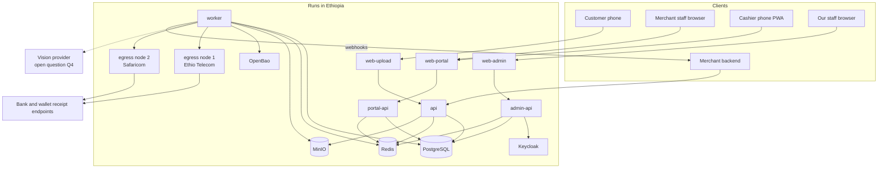
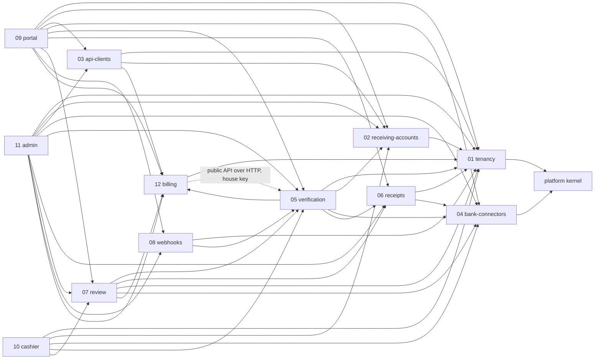
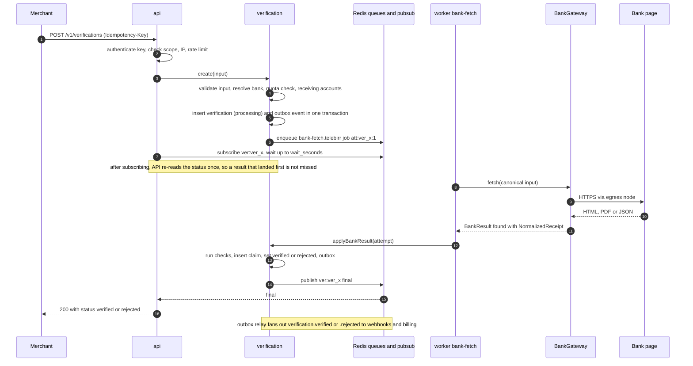
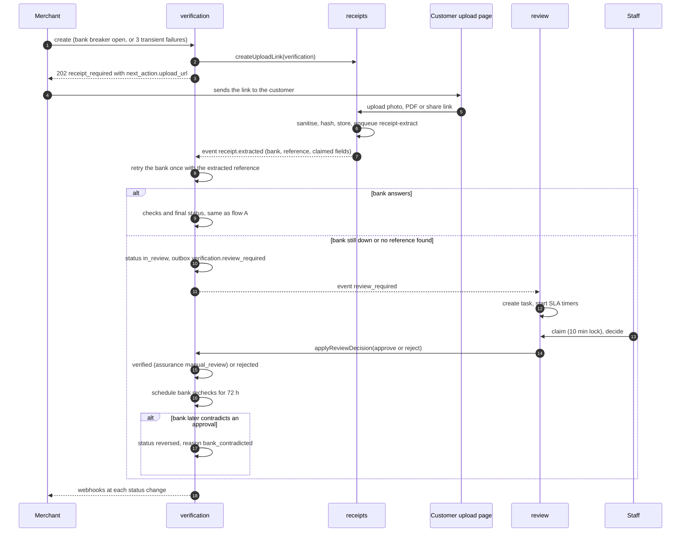
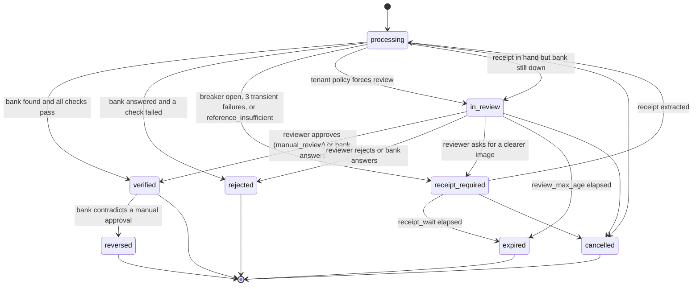
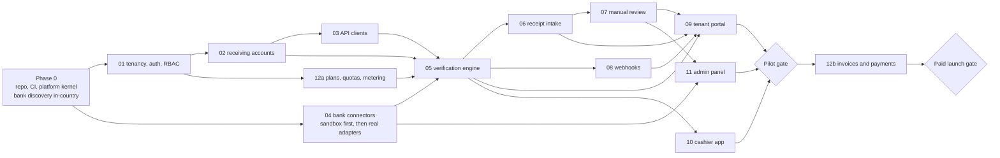

# Proofline: implementation overview

| | |
| --- | --- |
| Status | Approved. Decisions R1–R15 accepted on 4 October 2026; the 12 feature docs are written. No application code yet. |
| Date | 4 October 2026 |
| Source of truth for screens | [UI mockups canvas](https://claude.ai/artifact/EYXDJVaKXKekjhuW3SPZdY) (sample data only) |
| Background | [Architecture & spec doc](https://claude.ai/code/artifact/b1798dd4-d875-4b2e-8dbd-8715e423c147) (research, bank endpoints, compliance) |
| Next | Build with Claude Code, step by step: `docs/build/plan.md` |

Proofline (working name) verifies bank-transfer payments for Ethiopian merchants. A merchant sends a bank reference and the amount it expects. We fetch the bank's record and answer `verified` or `rejected` with a reason. If the bank can't be reached, we collect the customer's receipt and route it to a human reviewer, then keep checking the bank for 72 hours afterwards.

This overview fixes the parts every feature shares: the deployables, how a verification moves through the system, the module boundaries, the shared platform modules and their interfaces, conventions, and the build order. Section 1 lists where the brief's rules conflicted with each other or with the mockups, and the decision taken for each. **All fifteen recommended defaults were accepted, and the feature docs use them.**

## Contents

1. [Rules review: accepted decisions](#1-rules-review-accepted-decisions)
2. [Tech stack](#2-tech-stack)
3. [Architecture](#3-architecture)
4. [Folder structure and module boundaries](#4-folder-structure-and-module-boundaries)
5. [Shared platform modules](#5-shared-platform-modules)
6. [Conventions](#6-conventions)
7. [Build order](#7-build-order)
8. [Open questions](#8-open-questions)

---

## 1. Rules review: accepted decisions

I checked every rule in the brief against the mockups, the architecture doc and the other rules. Fifteen needed a decision. The **Decision** column is what was accepted on 4 October 2026 and what the feature docs specify.

| # | Rule as given | Problem | Decision (accepted) | Affects |
| --- | --- | --- | --- | --- |
| R1 | Statuses: processing, verified, rejected, receipt_required, in_review, expired | The review rule says an approval is *reversed* if the bank later disagrees, but no status represents that. The architecture doc's cancel endpoint needs a `cancelled` status. | Add `reversed` (final; only reachable from `verified` with `assurance = manual_review`) and `cancelled` (final; client cancels a non-final verification). That makes 8 statuses. | 05, 07, 08, 09 |
| R2 | Rejection reasons (7 listed) | The checks include "transfer completed" but no reason covers its failure. A reversal also needs a reason. | Add `not_completed` ("Transfer not completed") and `bank_contradicted` (reversal reason). The full list of `rejected` reasons becomes: `duplicate` (receipt already used), `receiver_mismatch` (paid to a different account), `not_found` (bank has no such transaction), `amount_mismatch` (amount less than expected), `stale` (payment too old), `suspected_forgery` (receipt looks altered), `unreadable_receipt` (receipt can't be read) and `not_completed`. `reversed` always carries `bank_contradicted`. Reviewers must pick a specific reason, so there is no generic "manual reject". A malformed reference is a `422 invalid_reference` error, not a rejection. | 05, 07 |
| R3 | "Reference not already claimed by any order at any merchant" | A global claim is right: one bank transaction should be claimable once on the whole platform. But a merchant who wasn't paid must not learn that another merchant claimed the reference. | Claims are unique per `(env, bank_code, official_reference)` across all tenants. The receiver check runs **before** the duplicate check, so a non-payee always gets `receiver_mismatch`. A duplicate rejection shows the first order's ID only when it belongs to the same tenant. | 05 |
| R4 | "Paid within the date window (24 h default)" | The mockups disagree. The Verify screen says "Paid in the last 24 h", the review workspace compares against "After 10:05" (order time), and the log drawer rejects a payment made 20 h before the order. | `window_start = expected.paid_after` if given, otherwise `created_at − tenant.date_window` (default 24 h). Pass if `window_start ≤ paid_at ≤ created_at + 5 min` (the 5 min covers clock skew). Mockup copy to be aligned to "Paid inside the allowed window". | 05, 09 |
| R5 | API request: bank_code, reference, expected.amount, external_id, wait_seconds | Some banks need more input. CBE Birr needs the payer's phone. BoA needs the last 5 digits of the receiving account. New CBE receipts are found by share link or QR token, not by FT number. | Add optional `payer_phone`, `expected.receiving_account_id`, `expected.paid_after` and `metadata`. `reference` also accepts a share link or pasted SMS text, and `bank_code` is optional when the input identifies the bank. BoA's 5 digits come from the tenant's registered account. A bare CBE FT number returns `receipt_required` with reason `reference_insufficient`. | 04, 05 |
| R6 | Amount "matches"; reason "amount less than expected" | "Matches" could mean equal or at least equal. Wallet receipts show both a settled amount and a total including fees. | Compare the **amount credited to the receiver** with `expected.amount`. Pass if credited ≥ expected, report `checks.amount = "over"` on overpayment, and add no tolerance. An `exact` mode is not offered at launch because it would need another reason label. | 04, 05 |
| R7 | Review modes: Platform or Hybrid | The architecture doc also had a Tenant-only mode. Hybrid's tenant stage has no SLA, and the role list has no tenant reviewer. | Two modes only. Hybrid: the tenant's Owners and Admins get the task first for `hybrid_tenant_window` (default 15 min, range 5–240). It then moves to the platform queue with the full plan SLA. | 07, 09 |
| R8 | Second approval above threshold "from a Review Lead" | Unclear for a high-value task approved by the tenant's own staff in Hybrid mode. | In the tenant stage, the second approval comes from a different tenant Owner or Admin. In the platform stage it comes from a Review Lead. The same person can never give both approvals. | 07 |
| R9 | SLA breach escalates to a Review Lead | Nothing ends a task nobody decides, and merchants need an answer eventually. | A breach escalates (priority bump, Review Lead alert). An `in_review` task still open after `review_max_age` (default 24 h) becomes `expired` with reason `review_timed_out`. | 05, 07 |
| R10 | Upload link expires after about 30 min | Nothing says when `receipt_required` itself ends. | Upload link TTL is exactly 30 min and can be reissued. `receipt_required` expires after `receipt_wait` (default 24 h) with reason `receipt_not_uploaded`. | 05, 06 |
| R11 | Cashier "scoped to their branch" | Branches don't exist in the data model yet. "Their own checks, scoped to their branch" could mean own checks or all branch checks; the mockup shows "My checks today". | Add a `branches` table in tenancy. A Cashier belongs to exactly one branch, and their checks are tagged with that branch. Cashiers see **only their own** checks; Owners and Admins can filter the log by branch. | 01, 05, 10 |
| R12 | Monthly check quotas (Growth = 10,000) | It's undefined what counts, and what happens at the limit. The mockup says "API checks", while an earlier plan draft made portal checks unlimited. | One check = one **live** verification that reaches `verified` or `rejected` through any channel (API, portal, cashier). Test mode, idempotent replays, `expired` and `cancelled` are free. At 80% and 100% we warn. Live checks are still served up to 120%, then new ones get `402 quota_exceeded` until the plan is upgraded or the month rolls over. The cap is set per plan in `billing.plans.hard_limit_pct`. Plans also carry `metered_channels` (all three at launch), and the quota blocks every live channel while a subscription is suspended for non-payment (doc 12). | 05, 12 |
| R13 | API scopes: verifications:read, verifications:write, receipts:write | `GET /v1/banks` has no scope. | `GET /v1/banks` is open to any valid key, and so is `GET /v1/receiving-accounts` (doc 02), which lists the tenant's verified accounts for `expected.receiving_account_id`. No new scope. | 02, 03 |
| R14 | "Live keys only work after the tenant's receiving accounts are verified" | It doesn't say whether one verified account is enough, or what happens for a bank with no account. | A live key works once the tenant is `active` (KYB approved, doc 01) and has at least one verified receiving account; until then live calls get `403 live_not_enabled`. A verification for a bank with no verified account gets `422 no_receiving_account`. | 02, 03, 05 |
| R15 | Rejection precedence | When several checks fail, the API returns one `reason`. The mockup shows "Receipt already used" while the date window also failed. | Primary reason by precedence: `receiver_mismatch` > `duplicate` > `not_completed` > `amount_mismatch` > `stale`. Every failed check is still listed in `checks`. | 05 |

Two smaller notes the docs will follow:

- **IDs.** The brief's `ver_<ULID>` stays. ULIDs are stored in Postgres `uuid` columns (both are 128-bit), which replaces the architecture doc's UUIDv7.
- **Money.** Amounts are stored as `bigint` santim (1 ETB = 100 santim) instead of `NUMERIC(14,2)`. That keeps arithmetic in integers end to end; see section 5.8.

Corrections to the UI spec and mockups that came out of the feature docs:

- **Upload page "Try another receipt (up to 3 tries)"** applies to an unreadable upload, which is not final (doc 06's retry flow, with "Send for review anyway"). A `rejected` verification is final, so its page shows "Return to merchant".
- **Usage meter "API checks this month"** becomes "Checks this month", because R12 counts every channel (09-Q1).
- **Log drawer "Date window" failing at 20 h** is sample data; under R4's 24 h default it passes (09-Q7).
- **Reason table:** `invalid_reference` is a `422` error and there is no `manual_reject` (R2; doc 09 section 6.2).
- **Cashier amount** is required, not optional (10-Q1).
- **Admin EN / አማ switch** appears only once admin Amharic exists (Q12, 11-Q1).

---

## 2. Tech stack

The stack below is the one you chose earlier (Node.js with NestJS and PostgreSQL), filled out to every layer. Versions are the current majors as of October 2026; exact versions get pinned when the repo is scaffolded.

| Layer | Choice | Why | Considered instead |
| --- | --- | --- | --- |
| Language and runtime | TypeScript 5 on Node.js 24 LTS | One language across API, workers and all four frontends, so the contracts and validation are shared rather than duplicated. | Go (faster, but splits the team's language and the shared contracts) |
| API framework | NestJS 11 on the Fastify adapter | Its module system maps one-to-one onto our feature modules. Dependency injection makes the bank adapters and storage swappable in tests. Guards and interceptors carry auth, tenancy and idempotency. | Plain Fastify (we would hand-build DI and module wiring) |
| Database | PostgreSQL 18 | Transactions for the state machine and claim registry. Row-level security for tenant isolation, partitioning for verification history, `SKIP LOCKED` for the outbox. | MySQL (weaker RLS story) |
| Data access | Drizzle ORM, with SQL migrations generated by drizzle-kit and committed per feature | Typed queries without hiding SQL. RLS policies, partitions and constraints are written as plain SQL in the same migrations. | Prisma (RLS and partitioning are awkward) |
| Queues and cache | BullMQ 5 on Redis 7 (Valkey 8 is a drop-in alternative) | Per-bank queues with their own rate limiters, delayed jobs for timers, and repeatable jobs for canaries. The same Redis serves rate limits, sessions and the pub/sub behind `wait_seconds`. | RabbitMQ (no delayed jobs without plugins; a second datastore) |
| Contracts and validation | zod schemas in `libs/contracts`, with OpenAPI 3.1 generated from them | One schema validates requests on the server and forms in the browser, and produces the public API docs and SDKs. | class-validator (doesn't share with the frontend) |
| Web frontends | Next.js 16 (App Router), React 19, Tailwind 4, Radix primitives, TanStack Table, next-intl | Server rendering for the portal and admin. The cashier app is a PWA, so there's no app-store release. next-intl handles EN/AM with ICU plurals. | Separate SPA plus a static site (two build systems) |
| Object storage | MinIO (S3 API), in-country | Receipts and raw bank responses must stay in Ethiopia (Proclamation 1321/2024). The S3 API keeps us portable. | Local disk (no replication) |
| Encryption keys | OpenBao (open-source, Vault-compatible) transit engine | Envelope encryption with one key per tenant, and key rotation without re-encrypting data. | Keys in env vars (no rotation or audit) |
| Staff sign-in | Keycloak (OIDC), with WebAuthn or TOTP required | SSO and MFA for the admin panel without sending staff identities abroad. | Hosted IdP (data leaves the country) |
| Bank I/O | undici, cheerio (HTML), pdfjs-dist (PDF), zxing-wasm (QR), sharp (images) | Pure Node, no external OCR service for the QR and PDF paths. | Headless browser everywhere (heavy; kept only as a last resort) |
| Observability | OpenTelemetry → Prometheus, Grafana, Loki, Tempo; GlitchTip (Sentry-compatible) | All self-hosted, so stack traces with customer data never leave the country. | Hosted APM (cross-border transfer) |
| Testing | Vitest, Testcontainers (Postgres, Redis, MinIO), Playwright, recorded bank fixtures | Integration tests against real dependencies, and end-to-end tests of all four surfaces. | Jest (slower in a monorepo) |
| Monorepo | pnpm workspaces and Turborepo | Each feature is its own package with its own build, tests and boundary rules (section 4). | Nx (heavier; we only need caching and task graphs) |
| Deploy | Docker images, k3s, Helm, GitHub Actions (or whichever CI you use) | Small cluster footprint that fits an in-country data centre. | Docker Compose (no rolling deploys) |

---

## 3. Architecture

### 3.1 Deployables

One TypeScript monorepo builds seven deployables. The four NestJS apps are thin bootstraps: each one mounts a subset of the same feature modules, so business logic exists once.

| Deployable | Kind | Public? | Auth | Mounts | Scales on |
| --- | --- | --- | --- | --- | --- |
| `api` | NestJS | Internet, `api.<domain>` | API key; upload-link token on `/hosted/v1` | Public REST `/v1`, hosted-upload endpoints `/hosted/v1` | Request rate |
| `portal-api` | NestJS | Internet, `portal.<domain>/api` | Session cookie + CSRF | Portal and cashier BFF `/portal/v1` | Request rate |
| `admin-api` | NestJS | Allowlisted networks only, `admin.<domain>/api` | Keycloak OIDC session | Admin BFF `/admin/v1` | Low, fixed |
| `worker` | NestJS (no HTTP) | Private | n/a (system principal) | Queue consumers, schedulers, outbox relay. `WORKER_GROUPS` picks which queues a pod runs. | Queue depth per group |
| `web-portal` | Next.js | Internet, `portal.<domain>` | Session | Tenant portal; cashier PWA under `/cashier` | Request rate |
| `web-upload` | Next.js, mostly static | Internet, `pay.<domain>` (separate origin, no cookies) | Upload-link token in the URL | Hosted upload page | Request rate |
| `web-admin` | Next.js | Allowlisted networks only, `admin.<domain>` | OIDC | Admin panel | Low, fixed |

The upload page gets its own origin. It is unauthenticated, handles untrusted files and has a 150 KB budget, so it shares no cookies or bundle with the portal.

Supporting infrastructure: PostgreSQL 18 (primary plus streaming replica), Redis 7, MinIO, OpenBao, Keycloak and ClamAV (`clamd`, scanning every upload; doc 06). Two **egress nodes** run forward proxies (Squid) on static IPs from two Ethiopian ISPs; every bank call leaves through one of them, and their allowlist holds bank hosts only. A separate **webhook egress** proxy sends merchant webhooks from published static IPs (doc 08). All of it runs in Ethiopia (open question Q3).



### 3.2 Feature modules

Each feature doc in `docs/features/` describes exactly one module. A module owns its Postgres schema and exposes one public interface; nothing else is importable.

| Doc | Package `@proofline/…` | Postgres schema | Owns | Main public interface | Emits | Consumes |
| --- | --- | --- | --- | --- | --- | --- |
| 01 | `tenancy` | `tenancy` | tenants (with KYB), branches, users, memberships, roles, sessions, invitations, tenant settings, platform staff | `TenancyApi`, `AccessResolver`, `SessionService` | `tenant.created`, `tenant.status_changed`, `tenant.kyb_decided`, `membership.*`, `tenant.settings_changed`, `branch.archived` | none |
| 02 | `receiving-accounts` | `receiving_accounts` | receiving accounts, ownership proofs | `ReceivingAccountsApi` (`hasVerified`, `listVerified`, `matchReceiver`) | `receiving_account.verified`, `.rejected`, `.removed` | `tenant.status_changed` |
| 03 | `api-clients` | `api_clients` | API clients, secrets, request logs | `ApiClientAuthenticator`, `ApiClientsApi` | `api_client.created`, `.updated`, `.rotated`, `.revoked` | `tenant.status_changed`, `receiving_account.verified`, `.removed`, `subscription.changed` |
| 04 | `bank-connectors` | `bank_connectors` | adapters, parser versions, breaker state, canary references, egress nodes, health samples, evidence | `BankRegistry`, `BankGateway`, `BankHealth` | `bank.breaker_changed`, `.format_changed`, `.adapter_toggled`, `.node_blocked`, `.parser_deployed` | none |
| 05 | `verification` | `verification` | verifications, attempts, claims, timeline events | `VerificationApi` | `verification.*` | `receipt.uploaded`, `.extracted`, `.extraction_failed`, `bank.breaker_changed`, `tenant.created` |
| 06 | `receipts` | `receipts` | receipts, upload links, extractions, image fingerprints | `ReceiptsApi` | `receipt.uploaded`, `.extracted`, `.extraction_failed`, `.claimed_fields_ready` | `verification.status_changed`, `review.task_created`, `review.escalated_to_platform` (hosted-page mirror), `tenant.settings_changed` |
| 07 | `review` | `review` | review tasks, actions, QA reviews | `ReviewApi` | `review.task_created`, `.decided`, `.sla_amber`, `.sla_breached`, `.escalated_to_platform`, `.task_closed` | `verification.review_required`, `.finalized`, `.reversed`, `.assurance_upgraded`, `.bank_confirmed_after_rejection`, `receipt.claimed_fields_ready` |
| 08 | `webhooks` | `webhooks` | endpoints, secrets, events, deliveries, attempts, replays | `WebhooksApi` | `webhook.endpoint_failing`, `.endpoint_disabled`, `.endpoint_recovered` | `verification.status_changed`, `tenant.status_changed` |
| 09 | `portal` | `portal` | saved views, exports | BFF controllers only | `export.ready`, `export.failed` | none |
| 10 | `cashier` | `cashier` | cashier devices and PINs | BFF controllers only | none | `membership.*`, `branch.archived`, `tenant.status_changed` |
| 11 | `admin` | `admin` | alerts feed, review shifts, staff preferences | BFF controllers only | none | `bank.*`, `review.sla_breached` |
| 12 | `billing` | `billing` | plans, subscriptions, usage events, counters, invoices, payments, credit notes | `QuotaService`, `PlansApi`, `UsageApi` | `usage.threshold_reached`, `subscription.changed`, `subscription.status_changed`, `invoice.issued`, `invoice.paid` | `tenant.created`, `tenant.status_changed`, `verification.finalized`, `receipt.extracted` |

Allowed dependencies form a DAG; a call against an arrow's direction must go through an event:



Four rules keep the graph honest:

- **Verification → receipts is one-way.** Verification calls `ReceiptsApi.createUploadLink()` synchronously, because the API response must include `next_action.upload_url`. Receipts reports back only by events (`receipt.extracted` and friends), so there is no cycle.
- **Review → verification is one-way.** Review calls `VerificationApi.applyReviewDecision()`. Verification asks for a review only by emitting `verification.review_required`.
- **Cross-module writes share the caller's transaction.** A callee that writes as part of the caller's state change (`attachStaged`, `attachShareLink`, `createUploadLink`, `invalidateUploadLinks`) takes the caller's `Tx` as its first argument, and says so in its public interface. No other cross-module write exists.
- **One HTTP exception.** Billing verifies tenants' invoice payments by calling our own public API with a house API key, exactly as a merchant would (doc 12, section 6.9). It never imports `@proofline/verification`, which would create a cycle, because verification depends on billing's `QuotaService`. The dashed edge in the graph is that call.

### 3.3 How a verification flows

**Flow A: the bank answers within the wait.** This is the common case.



If the wait runs out first, the API returns `202` with `status: processing`, and the final answer arrives by webhook.

**Flow B: the bank is down, a receipt comes in, and a human decides.**



**Flow C: cashier and portal checks.** These go through the same `VerificationApi.create()` with `channel = cashier` or `portal` and `wait_seconds = 15`. A cashier's verification carries their `branch_id` and `created_by_user_id`. Nothing else differs, so one engine serves every surface.

### 3.4 Verification states (summary)

Doc 05 defines every transition, guard and timer. This is the shape, including R1's two added statuses:



### 3.5 Sync versus async

| Work | Where it runs | Why |
| --- | --- | --- |
| Auth, scope, IP allowlist, rate limit, idempotency lookup | API request | Must reject before any work is done |
| Input validation, bank detection, receiving-account resolution, quota check | API request | Errors must come back as 4xx on the same call |
| Insert verification and enqueue the first bank attempt | API request (one transaction plus enqueue) | The ID must exist before we answer |
| Waiting for a final status up to `wait_seconds` (0–15) | API request: subscribe to Redis channel `ver:{id}`, re-read the row once, wait, then re-read the row again at timeout | Lets simple integrations skip webhooks. The two reads cover a result published before the subscription and a lost pub/sub message. |
| Bank fetch and parse, retries, `not_found` rechecks | `worker`, queues `bank-fetch.{bank}` | Slow and failure-prone; isolated per bank |
| Upload streaming, magic-byte check, sha256 | API request (`/hosted/v1`) | The customer needs an immediate yes or no on the file |
| Image sanitising, QR, PDF text, vision, perceptual hash | `worker`, queue `receipt-extract` | CPU-heavy, and vision is slow |
| Review claim and decision | `admin-api` or `portal-api` request | A human waits on the result |
| SLA timers, hybrid escalation, expiry, post-decision rechecks | `worker`, delayed jobs | Time-based |
| Webhook delivery | `worker`, queue `webhook-deliver` | Merchant endpoints are slow and can fail |
| Usage counting | Outbox consumer in `worker` | Must never slow down or fail a verification |
| Exports, invoices, retention purge, canaries, audit chain check | `worker`, repeatable or on-demand jobs | Batch work |

### 3.6 Queues and workers

All queues are BullMQ queues in the `pl:` key prefix. Job IDs are deterministic, so enqueueing the same job twice is a no-op.

| Queue | Producer | Job ID | Consumer | Concurrency (default) | Retries |
| --- | --- | --- | --- | --- | --- |
| `bank-fetch.cbe`, `.telebirr`, `.boa`, `.dashen`, `.awash`, `.cbebirr`, `.mpesa` | verification | `att:{verificationId}:{attemptNo}` | `BankFetchProcessor` (05 drives it, 04 performs the fetch) | 8 per bank per pod, plus a BullMQ limiter of `BANK_{CODE}_MAX_RPS` (doc 04: 10 per second for TELEBIRR and CBE, 5 for the others) | None at the job level. The engine schedules the next attempt itself, so retry policy lives in one place (doc 05). |
| `receipt-extract` | receipts | `rx:{receiptId}:{kind}` (`reference` or `claimed_fields`) | `ReceiptExtractProcessor` (06) | 4 per pod | 3 attempts (retries after 10 s and 60 s); then `receipt.extraction_failed` with `cause: processing_error` |
| `verification-timers` | verification | `vt:{verificationId}:{kind}:{dueAtEpoch}`; repeatable sweeper `vt:sweep` every 30 s (re-enqueues lost attempts) | `VerificationTimerProcessor` (05) | 16 | 5 attempts, exponential from 5 s |
| `review-timers` | review | `rt:{taskId}:{kind}:{dueAtEpoch}` (`amber`, `due`; a stage change arms new IDs), `rt:{taskId}:sandbox`; repeatable `rt:qa:{date}` (07:00 EAT) | `ReviewTimerProcessor` (07) | 8 | 5 attempts, exponential from 5 s |
| `webhook-deliver` | webhooks | `whd:{deliveryId}:{attemptNo}`; replays `whr:{replayId}`; repeatable sweeper `whs:sweep` every 30 s | `WebhookDeliveryProcessor` (08) | 32, at most 10 in flight per endpoint | None at the job level; doc 08 schedules 10 attempts over about 24 h |
| `canary` | bank-connectors (repeatable) | `can:{bank}:{node}` every 120 s | `CanaryProcessor` (04) | 14 (7 banks × 2 nodes) | None; the next run supersedes it |
| `exports` | portal | `exp:{exportId}` | `ExportProcessor` (09) | 2 | 3 attempts |
| `billing` | billing | `bill:close:{period}` (1st, 00:10 EAT), `bill:dunning:{date}` (08:00 EAT), `bill:reconcile:{hour}`, `bill:pay:{paymentId}:{n}` | `BillingProcessor` (12) | 4 | 5 attempts |
| `maintenance` | platform (repeatable) | `mnt:{kind}:{date}` | retention purge 02:00 EAT (receipts, evidence, request logs, webhook logs, exports, alerts, staging orphans, test-env verifications after 30 days), audit-chain check and the daily canary-coverage check 03:00 EAT, audit-chain check 03:00 EAT, partition creation 04:00 EAT (each feature registers its partitioned tables) | 1 | 3 attempts |

The outbox relay is a loop rather than a queue (section 5.14). `WORKER_GROUPS` (for example `bank,receipt` or `timers,webhooks,maintenance`) lets one image run as differently sized pods.

### 3.7 Domain events

Events are written to the outbox in the same transaction as the state change, then relayed to subscribers at least once. Every subscriber is idempotent through the inbox table (section 5.14). Payloads carry IDs and the minimum facts consumers need, never PII. Doc 05's events also carry the verification's `created_at`, so consumers can prune partitions.

| Event | Emitted by | Payload (besides `tenant_id`, `env`) | Consumed by |
| --- | --- | --- | --- |
| `tenant.created` | 01 | `tenant_id` | 05 (seeds the sandbox duplicate claims), 12 (Sandbox subscription) |
| `tenant.status_changed` | 01 | `from`, `to`, `reason` | 02, 03, 08, 10, 12 |
| `tenant.kyb_decided` | 01 | `decision`, `reason` | none (doc 01 sends the email itself) |
| `tenant.settings_changed` | 01 | `keys[]` | 01 (settings cache), 06 (retention recompute) |
| `membership.created`, `.updated`, `.removed` | 01 | `membership_id`, `user_id`, `role`, `branch_id` | 10 |
| `branch.archived` | 01 | `branch_id` | 10 |
| `receiving_account.verified`, `.removed`, `.rejected` | 02 | `account_id`, `bank_code` or `reason` | 03 (live-gate cache); `Notify` for rejections |
| `api_client.*` | 03 | `client_id` | none (audit only) |
| `bank.breaker_changed` | 04 | `bank_code`, `from`, `to`, `cause`, `forced` | 05 (re-queues waiting work when closed), 11 |
| `bank.format_changed`, `.adapter_toggled`, `.node_blocked`, `.parser_deployed` | 04 | `bank_code` and details | 11 |
| `verification.created` | 05 | `verification_id`, `bank_code`, `channel`, `branch_id` | none at launch |
| `verification.status_changed` | 05 | `verification_id`, `from`, `to`, `reason`, `review_reason`, `assurance` | 06 (hosted-page mirror), 08 (public webhook events) |
| `verification.finalized` | 05 | `verification_id`, `status`, `reason`, `assurance`, `amount_minor`, `bank_code`, `channel`, `billable`, `reviewed_by` | 07, 12 |
| `verification.review_required` | 05 | `verification_id`, `review_reason`, `amount_minor`, `bank_code` | 07 |
| `verification.reversed`, `.assurance_upgraded`, `.bank_confirmed_after_rejection` | 05 | `verification_id` (plus `failed_checks`) | 07; `Notify` emails tenant Owners and Admins on `bank_confirmed_after_rejection` |
| `receipt.uploaded` | 06 | `receipt_id`, `verification_id`, `source` | 05 (timeline) |
| `receipt.extracted` | 06 | `receipt_id`, `verification_id`, `bank_code`, `candidates[]`, `has_claimed_fields` | 05, 12 (image credits) |
| `receipt.extraction_failed` | 06 | `receipt_id`, `verification_id`, `cause`, `final` | 05 (acts only on `final: true`) |
| `receipt.claimed_fields_ready` | 06 | `receipt_id`, `verification_id` | 07 (workspace refresh) |
| `review.sla_breached` | 07 | `task_id`, `number`, `amount_minor` | 11 (alerts feed), `Notify` (Review Leads) |
| `review.task_created` | 07 | `task_id`, `verification_id`, `stage`, `due_at`, `high_value` | 06 (review time on the hosted In review page) |
| `review.escalated_to_platform` | 07 | `task_id`, `verification_id`, `cause`, `due_at` | 06 (updates the hosted In review time) |
| `review.decided`, `.sla_amber`, `.task_closed` | 07 | `task_id` and details | none at launch. Decisions reach 05 through the direct `applyReviewDecision()` call, never through this event, so they can't be applied twice |
| `webhook.endpoint_failing`, `.endpoint_disabled`, `.endpoint_recovered` | 08 | `endpoint_id` and details | 08's notifier (emails) |
| `export.ready`, `export.failed` | 09 | `export_id`, `requested_by_user_id`, and `row_count` or `error_code` | 09's notifier |
| `usage.threshold_reached` | 12 | `period`, `pct` (80, 100 or 120) | 12's notifier |
| `subscription.changed` | 12 | `from_plan_id`, `to_plan_id`, `effective_at`, `kind` | 03 (drops the cached plan) |
| `subscription.status_changed`, `invoice.issued`, `invoice.paid` | 12 | IDs and amounts | 12's notifier |

### 3.8 Global service targets

These come from the architecture doc. Each feature doc's Performance section breaks them down.

| Target | Value |
| --- | --- |
| API availability, excluding bank outages | 99.9% per month |
| Reference verification, bank healthy, end to end | p95 under 5 s |
| API overhead excluding the bank call | p95 under 150 ms |
| Webhook first delivery after a status change | p95 under 60 s |
| Upload page, 3G phone | Under 150 KB JS and CSS; largest content paint under 2.5 s |

---

## 4. Folder structure and module boundaries

```text
proofline/
├─ apps/
│  ├─ api/                 NestJS bootstrap: public /v1 and /hosted/v1 controllers
│  ├─ portal-api/          NestJS bootstrap: /portal/v1 (portal and cashier BFF)
│  ├─ admin-api/           NestJS bootstrap: /admin/v1 (admin BFF)
│  ├─ worker/              NestJS bootstrap: processors, schedulers, outbox relay
│  ├─ web-portal/          Next.js: tenant portal, cashier PWA at /cashier
│  ├─ web-upload/          Next.js: hosted upload page
│  └─ web-admin/           Next.js: admin panel
├─ libs/
│  ├─ platform/            shared kernel, no business rules (section 5)
│  │  ├─ config/  context/  db/  ids/  money/  errors/  logging/  telemetry/
│  │  ├─ i18n/  pii/  crypto/  storage/  queue/  outbox/  audit/  authz/
│  │  ├─ http/  idempotency/  rate-limit/  clock/  notify/  testing/
│  ├─ features/
│  │  ├─ tenancy/              01
│  │  ├─ receiving-accounts/   02
│  │  ├─ api-clients/          03
│  │  ├─ bank-connectors/      04
│  │  ├─ verification/         05
│  │  ├─ receipts/             06
│  │  ├─ review/               07
│  │  ├─ webhooks/             08
│  │  ├─ portal/               09
│  │  ├─ cashier/              10
│  │  ├─ admin/                11
│  │  └─ billing/              12
│  ├─ contracts/           zod schemas, public and BFF types, error codes, OpenAPI build, i18n catalogues
│  └─ ui/                  React design system: tokens, StatusBadge, Money, DataTable, DetailDrawer…
├─ infra/                  Dockerfiles, Helm charts, egress proxy config, Grafana dashboards, alert rules
├─ tools/                  fixture recorder, seed data, codegen
└─ docs/                   this overview, features/, runbooks/, adr/
```

Every feature package has the same internal layout:

```text
libs/features/verification/
├─ package.json            name "@proofline/verification"; "exports" maps "." to src/public/index.ts only
├─ src/
│  ├─ public/              the ONLY importable surface
│  │  ├─ index.ts          exports: VerificationModule, VerificationApi (interface), DTO types, event types
│  │  ├─ verification-api.ts
│  │  └─ events.ts
│  ├─ domain/              pure logic: state machine, checks, value objects (no I/O, no Nest)
│  ├─ application/         use cases: orchestrate domain plus ports
│  ├─ infrastructure/      Drizzle repositories, queue processors, adapters for ports
│  ├─ http/
│  │  ├─ public-api/       controllers mounted by apps/api
│  │  ├─ portal/           controllers mounted by apps/portal-api
│  │  └─ admin/            controllers mounted by apps/admin-api
│  └─ db/
│     ├─ schema.ts         Drizzle table definitions for schema "verification"
│     └─ migrations/       0001_init.sql, 0002_….sql (applied in feature order)
└─ test/
   ├─ unit/  integration/  fixtures/
```

**Boundary rules.** CI fails if any of these is broken.

1. A feature imports another feature only as `@proofline/<name>`. Because each `package.json` `"exports"` field exposes only `src/public/index.ts`, Node resolution itself rejects deep imports such as `@proofline/verification/src/domain/...`.
2. Imports must follow the DAG in section 3.2. `eslint-plugin-boundaries` enforces the allowed pairs, and `dependency-cruiser` fails the build on any cycle.
3. `libs/platform` never imports from `libs/features`. Where the platform needs feature knowledge (for example, which permissions a user has), it defines a port such as `AccessResolver`, and the feature registers the implementation.
4. Each feature owns one Postgres schema. Its code reads and writes only that schema. The only cross-schema foreign keys allowed point at `tenancy.tenants(id)`; any other reference to another feature's row is a plain `uuid` column checked through that feature's interface.
5. No cross-feature SQL joins. Screens that need data from several features (the portal log, the admin dashboard) call several interfaces, or read a read model the feature built from events.
6. A feature never writes another feature's data. It calls the owner's interface or emits an event.
7. Apps contain only bootstraps and module wiring; no business logic lives in `apps/`.
8. Each feature has its own test suite that runs with only its own schema migrated, plus `platform`, `audit` and `tenancy`. Other features are replaced with in-memory fakes of their public interfaces, published from each package's `testing` export.
9. A synchronous call that writes as part of the caller's state change passes the caller's `Tx` explicitly (section 3.2). Interfaces mark those methods by taking `tx: Tx` first.
10. No feature calls another over HTTP. The single exception is billing's payment verification through the public API (section 3.2, doc 12).

---

## 5. Shared platform modules

Everything in `libs/platform` is mechanism, not policy. Signatures below are the public interfaces; each feature doc uses them by these names.

### 5.1 Config (`@proofline/platform/config`)

```ts
// Validated once at boot; the process exits with code 78 (EX_CONFIG) listing every invalid variable.
export const EnvSchema = z.object({
  NODE_ENV: z.enum(['development', 'test', 'production']),
  APP_NAME: z.enum(['api', 'portal-api', 'admin-api', 'worker']),
  DATABASE_URL: z.string().url(),
  DATABASE_REPLICA_URL: z.string().url().optional(),
  REDIS_URL: z.string().url(),
  S3_ENDPOINT: z.string().url(), S3_ACCESS_KEY: z.string(), S3_SECRET_KEY: z.string(),
  OPENBAO_ADDR: z.string().url(), OPENBAO_ROLE_ID: z.string(), OPENBAO_SECRET_ID: z.string(),
  PUBLIC_API_BASE_URL: z.string().url(),     // https://api.<domain>
  UPLOAD_BASE_URL: z.string().url(),         // https://pay.<domain>
  PORTAL_BASE_URL: z.string().url(),
  ADMIN_BASE_URL: z.string().url(),
  LOG_LEVEL: z.enum(['debug', 'info', 'warn', 'error']).default('info'),
  OTEL_EXPORTER_OTLP_ENDPOINT: z.string().url(),
  WORKER_GROUPS: z.string().optional(),      // comma list, worker only
});
export interface ConfigService { get<K extends keyof Env>(key: K): Env[K]; }
```

Feature-specific variables (bank limits, SLA defaults and so on) are declared by each feature in its own zod schema, merged at boot, and listed in that doc's Configuration section. Per-tenant settings live in `tenancy` (section 5.4). Feature flags:

```ts
export interface FeatureFlags {
  isEnabled(key: FlagKey, scope: { tenantId?: string; env?: EnvName }): Promise<boolean>; // cached 30 s
}
// Table platform.feature_flags(key text pk, default_enabled bool, rules jsonb, updated_at, updated_by)
// rules: [{ "tenant_ids": [...], "enabled": true }]; first matching rule wins.
export interface FeatureFlagsAdmin {          // admin Settings (doc 11); changes are audited
  list(): Promise<FlagView[]>;
  set(key: FlagKey, v: { defaultEnabled: boolean; rules: FlagRule[] }, actor: Actor): Promise<FlagView>;
}
export interface ConfigRegistry {             // read-only "effective configuration" page (doc 11)
  describe(): { module: string; key: string; value: string | null; secret: boolean; source: 'env' | 'default' }[];  // secrets: value null
}
```

### 5.2 Request context (`@proofline/platform/context`)

```ts
export type EnvName = 'live' | 'test';
export type Locale = 'en' | 'am';

export type Principal =
  | { kind: 'api_client'; apiClientId: string; tenantId: string; env: EnvName; scopes: ApiScope[] }
  | { kind: 'user'; userId: string; sessionId: string; tenantId: string; env: EnvName;
      membershipId: string; roles: TenantRole[]; branchId: string | null }
  | { kind: 'staff'; staffId: string; sessionId: string; roles: PlatformRole[] }
  | { kind: 'upload_link'; uploadLinkId: string; verificationId: string; tenantId: string; env: EnvName }
  | { kind: 'system'; job: string; tenantId: string | null; env: EnvName | null };

export interface RequestContext {
  requestId: string;   // req_<ULID>, echoed as X-Request-Id
  traceId: string;     // OpenTelemetry
  principal: Principal;
  locale: Locale;
  ip: string;
  userAgent: string | null;
}
export const Ctx: {
  get(): RequestContext;                                    // throws if called outside a context
  run<T>(ctx: RequestContext, fn: () => Promise<T>): Promise<T>; // AsyncLocalStorage
  tenantScope(): { tenantId: string; env: EnvName } | null; // derived from principal
};
```

Queue processors open a context with a `system` principal carrying the job's tenant and env, so the same repositories and RLS apply in workers.

### 5.3 Auth and authorization (`@proofline/platform/authz`)

The platform supplies guards and decorators. Feature 01 decides who has which permission and implements the port; feature 03 implements API-key authentication.

```ts
export type Permission = string & { __brand: 'Permission' }; // catalogue owned by doc 01, e.g. 'verifications.read'

export interface AccessResolver {                            // port, implemented by @proofline/tenancy
  permissionsFor(p: Principal): Promise<ReadonlySet<Permission>>;
  dataScopeFor(p: Principal, resource: 'verification' | 'review_task' | 'receipt'): Promise<DataScope>;
}
export type DataScope =
  | { kind: 'platform' }                                     // staff, admin-api only
  | { kind: 'tenant'; tenantId: string; env: EnvName }
  | { kind: 'branch'; tenantId: string; env: EnvName; branchId: string }
  | { kind: 'own'; tenantId: string; env: EnvName; userId: string };   // Cashier

export function RequirePermission(...p: Permission[]): ClassDecorator & MethodDecorator;
export function RequireScope(...s: ApiScope[]): MethodDecorator;   // API clients
export function Public(): MethodDecorator;                           // explicitly unauthenticated
```

| Surface | Principal | Mechanism (detail in doc) |
| --- | --- | --- |
| Public API | `api_client` | `Authorization: Bearer pvk_{live\|test}_{keyId}.{secret}`; secret compared as peppered SHA-256 in constant time; IP allowlist (03) |
| Hosted upload | `upload_link` | 32-byte random token in the URL path, stored as SHA-256, single verification, TTL 30 min (06) |
| Portal | `user` | `pl_session` cookie (HttpOnly, Secure, SameSite=Lax), server-side session, CSRF double-submit header, TOTP or WebAuthn MFA (01) |
| Cashier PWA | `user` with `verifications.create` (Cashiers, or another role that enrolled a device; 10-Q4) | Device-bound session cookie `pl_cashier`, scoped to the cashier API path, plus a server-enforced 6-digit PIN unlock (10) |
| Admin | `staff` | Keycloak OIDC, mandatory WebAuthn or TOTP, network allowlist (01, 11) |

Every route is denied by default. A route without `@RequirePermission`, `@RequireScope` or `@Public` fails a boot-time check.

### 5.4 Tenancy and Live/Test isolation (`@proofline/platform/db` plus feature 01)

- Every env-scoped tenant row carries `tenant_id uuid NOT NULL` and `env text NOT NULL CHECK (env IN ('live','test'))`.
- Some tenant data is the same in both envs and carries `tenant_id` only, with an RLS policy on `tenant_id` alone: the tenancy tables (doc 01), `portal.saved_views` (09), `cashier.devices` (10, live-only) and the billing tables (12, live usage only).
- `Db.tx()` begins every transaction with `SET LOCAL app.tenant_id`, `app.env` and `app.principal_kind` taken from the context. Each tenant-owned table has `ENABLE ROW LEVEL SECURITY` and `FORCE ROW LEVEL SECURITY`, with:

  ```sql
  CREATE POLICY tenant_isolation ON verification.verifications
    USING (tenant_id = current_setting('app.tenant_id', true)::uuid
           AND env = current_setting('app.env', true))
    WITH CHECK (tenant_id = current_setting('app.tenant_id', true)::uuid
                AND env = current_setting('app.env', true));
  ```

- Database roles: `pl_app` (all tenant apps and workers, subject to RLS); `pl_admin` (admin-api only, with an extra policy allowing cross-tenant `SELECT` when `app.principal_kind = 'staff'`); `pl_migrator` (DDL only, used by the migration job). No role has `BYPASSRLS`.
- Staff never write across tenants in one transaction. When a reviewer decides a task, admin-api opens the transaction with `app.tenant_id` and `app.env` set to that task's tenant, so the write goes through the normal RLS policy. Cross-tenant access is read-only, for lists and dashboards.
- **Test mode never calls a bank.** In `test`, `BankGateway` routes to the sandbox connector, which returns fixed outcomes for the magic references (doc 04). Test verifications aren't billable, use separate keys (`pvk_test_`), deliver only to test webhook endpoints, and are purged after 30 days.
- Claims, idempotency keys, webhook endpoints, API clients and receiving accounts are all per env. A test verification can never claim a live reference.
- The portal's Live/Test switch changes `env` on the server-side session. The cashier PWA is live-only.
- API objects carry `livemode: true|false` so integrators can't mix them up.

```ts
export interface Db {
  tx<T>(fn: (tx: Tx) => Promise<T>, opts?: { isolation?: 'read committed' | 'repeatable read' | 'serializable';
        readOnly?: boolean; useReplica?: boolean }): Promise<T>;
}
```

### 5.5 RBAC

Roles are bundles of permission strings stored as data, so adding a role is a migration, not a code change. Doc 01 owns the full catalogue and matrix. The roles at launch follow the brief:

| Side | Role | Summary (exact permissions in doc 01) |
| --- | --- | --- |
| Platform | Reviewer | Claim and decide review tasks below the high-value threshold |
| Platform | Review Lead | Everything a Reviewer can do, plus second approvals, reassigning tasks and QA sampling |
| Platform | Admin | Tenants, plans, bank adapters, staff, audit log, billing, settings |
| Tenant | Owner | Everything in the tenant, including billing and closing the account |
| Tenant | Admin | Users, branches, receiving accounts, review policy, webhooks; review tasks in Hybrid mode |
| Tenant | Developer | API clients, webhooks, request logs, sandbox, raw responses |
| Tenant | Cashier | Verify; their own checks only, tagged to their branch (R11) |

Data scope is enforced in repositories, not controllers: every list or get function takes a `DataScope` and adds the matching `WHERE` clause. RLS is the second line of defence for tenant and env.

### 5.6 Audit log (`@proofline/platform/audit`)

The audit log records human and security actions: sign-ins, role changes, key create, rotate and revoke, receiving-account changes, review claims and decisions, PII reveals, settings changes, plan changes and break-glass access. Verification lifecycle steps go to the verification timeline instead (doc 05), because they are high-volume and not human actions.

```ts
export interface AuditEvent {
  action: AuditAction;               // 'review.decided', 'api_client.revoked', 'pii.revealed', …
  targetType: string;                // 'review_task', 'api_client', …
  targetId: string;
  tenantId: string | null;
  env: EnvName | null;
  metadata?: Record<string, string | number | boolean | null>; // no PII
}
export interface AuditLog {
  record(tx: Tx, e: AuditEvent): Promise<void>;   // actor, ip, request_id from Ctx
}
```

Table `audit.events`: `id uuid`, `seq bigint generated always as identity`, `at timestamptz`, `actor_kind`, `actor_id`, `tenant_id`, `env`, `action`, `target_type`, `target_id`, `ip inet`, `request_id`, `metadata jsonb`, `prev_hash bytea`, `hash bytea`.

`hash = sha256(prev_hash || canonical_json(row without hash))`. Writers take `pg_advisory_xact_lock(7300001)` so the chain is linear. `pl_app` has `INSERT` and `SELECT` only. A daily `maintenance` job re-walks the chain and alerts on any break.

```ts
export interface AuditReader {                 // admin Audit log and tenant Activity tab (doc 11)
  list(f: AuditFilter, page: { cursor?: string; limit: number }): Promise<Page<AuditEventView>>;
  chainStatus(): Promise<{ checkedAt: Date | null; ok: boolean; brokenAtSeq: number | null }>;
  stream(f: AuditFilter): AsyncIterable<AuditEventView>;   // CSV export
}
```

### 5.7 i18n and the Ethiopian calendar (`@proofline/platform/i18n`)

- **Locales:** `en` and `am`. Catalogues are ICU message files in `libs/contracts/i18n/{en,am}/{common,status,reason,errors,email,portal,cashier,upload,admin}.json`, shared by backend and frontends. Keys look like `status.verified`, `reason.duplicate`, `upload.title`. A CI check fails if any key exists in one locale but not the other.
- **Coverage:** the upload page, cashier app and portal are bilingual. The admin panel is English at launch (Q12).
- **Locale choice:** an explicit user setting, else the `lang` query parameter (upload links), else `Accept-Language`, else the tenant default, else `en`.
- **Time:** stored as UTC `timestamptz`, always shown in `Africa/Addis_Ababa` (UTC+03:00, no DST) on a 24-hour clock. Amharic uses the standard clock, not the local six-hour offset.
- **Dates:** English shows Gregorian (`3 Oct 2026, 14:20`). Amharic shows Ethiopian (`መስከረም 23, 2019 ዓ.ም. · 14:20`), with the Gregorian date as a tooltip; users can switch.

```ts
export interface EthiopianDate { year: number; month: number; /* 1..13 */ day: number; /* 1..30; Pagume 1..5 or 6 */ }
export function toEthiopian(instant: Date): EthiopianDate;          // in Africa/Addis_Ababa
export function fromEthiopian(d: EthiopianDate): { year: number; month: number; day: number }; // Gregorian civil date
export function formatInstant(instant: Date, locale: Locale, style: 'date' | 'datetime' | 'time'): string;
export function t(locale: Locale, key: MessageKey, params?: Record<string, string | number>): string;

// Algorithm (Dershowitz and Reingold). Ethiopic epoch = R.D. 2796; R.D. = days since 0001-01-01 proleptic Gregorian, day 1.
// fixedFromEthiopic(y, m, d) = 2796 - 1 + 365*(y-1) + floor(y/4) + 30*(m-1) + d
// year  = floor((4*(f - 2796) + 1463) / 1461)
// month = floor((f - fixedFromEthiopic(year, 1, 1)) / 30) + 1
// day   = f + 1 - fixedFromEthiopic(year, month, 1)
export const AM_MONTHS = ['መስከረም','ጥቅምት','ኅዳር','ታኅሣሥ','ጥር','የካቲት','መጋቢት','ሚያዝያ','ግንቦት','ሰኔ','ሐምሌ','ነሐሴ','ጳጉሜን'] as const;
```

Required test vectors (checked against the algorithm while writing this doc):

| Gregorian (EAT) | Ethiopian | Why it matters |
| --- | --- | --- |
| 2026-09-10 | ጳጉሜን 5, 2018 | Last day of a common year |
| 2026-09-11 | መስከረም 1, 2019 | New Year |
| 2026-10-03 | መስከረም 23, 2019 | Matches the cashier mockup |
| 2026-01-07 | ታኅሣሥ 29, 2018 | Genna (Ethiopian Christmas) |
| 2027-09-11 | ጳጉሜን 6, 2019 | Leap Pagume |
| 2027-09-12 | መስከረም 1, 2020 | New Year after a leap year |
| 2024-02-29 | የካቲት 21, 2016 | Gregorian leap day |
| 2026-10-03T21:30:00Z | መስከረም 24, 2019 | UTC evening that is already the next day in EAT |

### 5.8 Money (`@proofline/platform/money`)

Amounts are never floats, anywhere: JavaScript `number` is banned for money by an ESLint rule on `Money` fields.

```ts
export type Currency = 'ETB';
export interface Money { readonly minor: bigint; readonly currency: Currency }  // minor = santim

export const Money: {
  of(minor: bigint, currency?: Currency): Money;
  /** API input. Regex ^(0|[1-9]\d{0,11})(\.\d{1,2})?$ ; "1500" and "1500.5" accepted; throws AppError invalid_amount. */
  fromDecimalString(s: string, currency?: Currency): Money;
  /** Bank text: strips "ETB", "Birr", "ብር", commas, NBSP, spaces; rejects more than 2 decimals or a negative sign. */
  fromBankText(s: string): Money;
  toDecimalString(m: Money): string;                 // always 2 decimals: "1500.00"
  format(m: Money, locale: Locale): string;          // en "ETB 1,500.00"; am "1,500.00 ብር"
  compare(a: Money, b: Money): -1 | 0 | 1;           // throws on currency mismatch
  add(a: Money, b: Money): Money;
  sub(a: Money, b: Money): Money;                    // throws if negative
};
```

- **Database:** `amount_minor bigint NOT NULL CHECK (amount_minor >= 0)` plus `currency char(3) NOT NULL DEFAULT 'ETB' CHECK (currency = 'ETB')`. Drizzle uses `bigint({ mode: 'bigint' })`.
- **JSON:** decimal strings only (`"12500.00"`). Upper bound: 999,999,999,999.99 ETB.

### 5.9 IDs (`@proofline/platform/ids`)

```ts
export type IdPrefix =
  | 'ten' | 'br' | 'usr' | 'mem' | 'stf' | 'ses' | 'inv'        // tenancy
  | 'racc'                                                       // receiving accounts
  | 'apc'                                                        // api client record (keys use pvk_ below)
  | 'ver' | 'att'                                                // verification, attempt
  | 'rcpt' | 'ul' | 'ext'                                        // receipt, upload link, extraction
  | 'rvw'                                                        // review task
  | 'whe' | 'whd' | 'evt'                                        // webhook endpoint, delivery, event
  | 'exp' | 'sv' | 'dev'                                         // export, saved view, cashier device
  | 'plan' | 'sub' | 'invc' | 'pay'                              // billing
  | 'req';                                                       // request id (not stored as a PK)

export function newId<P extends IdPrefix>(p: P): `${P}_${string}`;            // ULID, monotonic within a ms
export function toUuid<P extends IdPrefix>(p: P, id: string): string;         // validates prefix and Crockford base32
export function fromUuid<P extends IdPrefix>(p: P, uuid: string): `${P}_${string}`;
```

- **Storage:** IDs are stored as Postgres `uuid` (the ULID's 128 bits). Prefixes exist only at the edges: APIs, logs and the UI.
- **API key IDs:** `pvk_live_` or `pvk_test_` plus 8 lowercase base36 characters, as in the mockup's `pvk_live_k7q2mx9a`. The secret is 32 base62 characters, and the full credential is `<keyId>.<secret>`.
- **Review tasks** also get a human number from a global sequence, shown as `RV-20418`.

### 5.10 PII: classification, encryption, masking (`@proofline/platform/pii`, `crypto`)

| Class | Examples | Storage | Shown |
| --- | --- | --- | --- |
| S (secret) | API secrets, passwords, PINs, upload tokens, webhook secrets | Hash only (argon2id for passwords and PINs; peppered SHA-256 for high-entropy tokens). Two exceptions are also stored encrypted: webhook secrets, because we must sign with them, and upload-link tokens, so an active link can be repeated in `GET` responses and webhooks (doc 06). | Shown once at creation. Webhook secrets can be revealed again after re-authentication, audited (doc 08). An active upload link is shown only to the merchant that owns it. |
| P (personal) | Payer name, payer phone, full account numbers, receipt images, raw bank responses | Envelope-encrypted with the tenant's key (OpenBao transit key `tenant-<id>`, data keys cached 5 min). An HMAC column alongside supports equality lookups. | Masked by default; payer name shown in full to the receiving tenant |
| I (internal) | IDs, amounts, bank codes, statuses | Plain | Yes |

```ts
export interface Crypto {
  encrypt(tenantId: string, plaintext: string | Buffer): Promise<Ciphertext>;  // "v1:<keyVersion>:<b64>"
  decrypt(tenantId: string, c: Ciphertext): Promise<Buffer>;
  hmac(purpose: 'account' | 'phone' | 'reference', value: string): Buffer;   // platform HMAC key per purpose
}
export function maskAccount(digits: string, visible = 4): string;   // "1000123456789" -> "****6789"
export function maskPhone(e164: string): string;                    // "251911234330" -> "+251 9•• ••• 330"
```

Rules every feature follows:

- Payer details are returned only when the receiver check passed (R3). On `receiver_mismatch` the response carries no payer fields.
- Unmasking requires the `pii.reveal` permission and a re-authentication within the last 5 minutes, and is audited (`pii.revealed`).
- Logs never contain class S or P data. The logger's redaction list covers `authorization`, `cookie`, `secret`, `password`, `pin`, `token`, `payer_*`, `account_number`, `phone` and `raw`.

### 5.11 Errors (`@proofline/platform/errors`)

```ts
export class AppError extends Error {
  constructor(
    readonly code: ErrorCode,           // from the catalogue, section 6.4
    readonly httpStatus: number,
    message?: string,                   // English, safe to show developers
    readonly field?: string,            // JSON path, e.g. "expected.amount"
    readonly details?: Record<string, unknown>,
    readonly retryable = false,
  ) { super(message ?? code); }
}
// Every HTTP error body:
// { "error": { "code": "missing_field", "message": "payer_phone is required for CBEBIRR",
//              "field": "payer_phone", "request_id": "req_01JB…", "retryable": false } }
```

Unknown exceptions become `500 internal_error` with no internal details; the stack trace goes to logs and GlitchTip with PII scrubbed. Domain outcomes such as a rejected payment are never errors (rule: a rejection is a `200`).

### 5.12 Logging, tracing, metrics (`@proofline/platform/logging`, `telemetry`)

- **Logs:** pino JSON to stdout, shipped to Loki. Fields on every line: `ts`, `level`, `msg`, `app`, `module`, `request_id`, `trace_id`, `span_id`, `tenant_id`, `env`, `principal_kind`, `principal_id`. Info level in production.
- **Tracing:** OpenTelemetry auto-instrumentation for HTTP, pg, ioredis and BullMQ. Each job carries the trace context of the request that enqueued it, so one verification is one trace from API call to webhook.
- **Metrics:** Prometheus, named `pl_<module>_<thing>_<unit>`, for example `pl_bank_fetch_duration_seconds{bank,outcome,node}`. Labels never include tenant IDs except on tenant-quota metrics, where cardinality is capped at the tenant count.
- **Request logs for tenants** (the portal's Request logs screen) are separate from operational logs. Doc 03 stores them with masked bodies and 30-day retention.

### 5.13 Database and migrations (`@proofline/platform/db`)

- One PostgreSQL database with one schema per feature, plus `platform` and `audit`.
- Migrations are plain SQL files per feature. A migration job runs them in DAG order (`platform`, `audit`, `tenancy`, `receiving_accounts`, …) as `pl_migrator` before each deploy.
- **Expand-and-contract only:** a release may add nullable columns, tables and indexes (`CREATE INDEX CONCURRENTLY`). Drops and renames land one release after code stops using them.
- `verification.verifications` and `verification_attempts` are range-partitioned by `created_at`, monthly. The maintenance job creates partitions three months ahead.
- **Statement timeouts:** `statement_timeout = 5s` for request paths, `60s` for workers. `idle_in_transaction_session_timeout = 10s`.
- Read-only dashboard queries may set `useReplica: true`.

### 5.14 Outbox and events (`@proofline/platform/outbox`)

```ts
export interface DomainEvent<T extends string = string, P = unknown> {
  id: string;                 // evt_<ULID>
  type: T;                    // 'verification.finalized'
  version: 1;
  occurredAt: string;         // RFC 3339 UTC
  tenantId: string | null;
  env: EnvName | null;
  payload: P;
}
export interface Outbox {
  publish<E extends DomainEvent>(tx: Tx, e: Omit<E, 'id' | 'occurredAt' | 'version'>): Promise<string>;
}
export function OnEvent(type: string, opts: { consumer: string; concurrency?: number }): MethodDecorator;
```

- `platform.outbox(id, type, payload jsonb, tenant_id, env, occurred_at, published_at null, attempts int)`. The relay in `worker` runs `LISTEN outbox_new` (with a 500 ms poll as fallback), claims rows with `FOR UPDATE SKIP LOCKED LIMIT 200`, calls each subscriber, and marks the row published.
- `platform.event_inbox(consumer text, event_id uuid, processed_at, PRIMARY KEY (consumer, event_id))`. Each handler inserts here in its own transaction; a conflict means "already processed, skip".
- A handler failing 10 times parks the event (`platform.outbox_dead`) and alerts. Other events keep flowing.
- Event payload schemas (zod) and the shared enums they use (statuses, reasons, bank codes) live in `libs/contracts/src/events/`. A consumer imports the schema from there, never from the emitting package, so consuming an event creates no package dependency and can go against a DAG arrow.

### 5.15 Queues (`@proofline/platform/queue`)

```ts
export interface JobDef<TName extends string, TData> { queue: TName; schema: z.ZodType<TData> }
export interface Queues {
  add<TData>(def: JobDef<string, TData>, data: TData,
             opts: { jobId: string; delayMs?: number; priority?: number }): Promise<void>;  // idempotent on jobId
  cancel(def: JobDef<string, unknown>, jobId: string): Promise<void>;
}
export function Processor(def: JobDef<string, unknown>, opts: { concurrency: number; group: string }): ClassDecorator;
```

Job data is validated with its zod schema when enqueued and again when processed. Jobs never carry PII; they carry IDs.

### 5.16 Idempotency (`@proofline/platform/idempotency`)

The behaviour is specified in doc 05; the mechanism is shared by every public `POST`.

```ts
export interface Idempotency {
  /** Runs fn once per (tenant, env, api client, key). Same key and same body hash: replays the stored response.
   *  Same key, different body: 409 idempotency_conflict. Still running: 409 idempotency_in_progress, Retry-After: 1. */
  run<T>(key: string, requestHash: string, fn: () => Promise<HttpResult<T>>): Promise<HttpResult<T>>;
}
```

Keys are stored in `platform.idempotency_keys` (unique on `tenant_id, env, api_client_id, key`), kept 24 h, with at most 255 printable ASCII characters. Responses replayed from storage carry `Idempotent-Replayed: true`.

### 5.17 Rate limiting (`@proofline/platform/rate-limit`)

A Redis token bucket. Limits per API client come from `PlansApi` (doc 12): Sandbox 10, Starter 60 and Growth 300 requests per minute, and 1,000 by default for Enterprise plans. The hosted upload endpoints are limited per IP (30 per minute) and per upload link (10 requests per minute; a link takes at most 3 uploads, doc 06). Responses include `RateLimit-Limit`, `RateLimit-Remaining` and `RateLimit-Reset`, and a `429` adds `Retry-After`.

### 5.18 Object storage (`@proofline/platform/storage`)

```ts
export interface ObjectStore {
  put(bucket: Bucket, key: string, body: Readable, meta: { contentType: string; sha256: string; tenantId: string }): Promise<void>;
  get(bucket: Bucket, key: string): Promise<Readable>;
  signedGetUrl(bucket: Bucket, key: string, ttlSeconds: 60 | 300): Promise<string>;
  delete(bucket: Bucket, key: string): Promise<void>;
}
export type Bucket = 'receipts' | 'bank-evidence' | 'exports' | 'kyb' | 'invoices';   // kyb: doc 01; invoices: doc 12 (kept 10 years)
// Default key layout: t/{tenantId}/{env}/{yyyy}/{mm}/{objectId}. Every key starts with t/{tenantId}/; a feature doc may define the rest
// (KYB documents, ownership proofs, receipts, invoices). Server-side encryption with OpenBao-managed keys. No public buckets.
```

### 5.19 Clock and notifications

- `Clock.now(): Date` is injected everywhere instead of `new Date()`. Tests use `FakeClock` to drive SLA timers, windows and expiries deterministically.
- `Notify.email(to, template, params, locale)` sends through an in-country SMTP relay. Templates live in the i18n catalogues. It is used for invitations, quota warnings, export-ready notices and failing webhook endpoints. Notification failures are logged and retried 5 times but never fail the triggering action.

---

## 6. Conventions

### 6.1 Naming

| Thing | Convention | Example |
| --- | --- | --- |
| TS files | kebab-case | `verification-api.ts` |
| Classes, types | PascalCase | `NormalizedReceipt` |
| Functions, variables | camelCase | `applyBankResult` |
| Postgres schemas, tables, columns | snake_case; tables plural | `verification.verifications.official_reference` |
| Timestamps | `*_at timestamptz` | `created_at`, `finalized_at` |
| Money columns | `*_minor bigint` plus `currency` | `expected_amount_minor` |
| Enums in DB | `text` with a `CHECK` constraint (no PG enum types, so adding values is easy) | `CHECK (status IN (...))` |
| URL path segments | kebab-case, plural nouns | `/v1/receiving-accounts`, `/portal/v1/verification-counts` |
| JSON over HTTP | snake_case keys; enum values lowercase snake_case | `"receipt_required"` |
| Bank codes | Uppercase | `CBE`, `TELEBIRR`, `BOA`, `DASHEN`, `AWASH`, `CBEBIRR`, `MPESA` |
| Events | `<entity>.<past_tense_or_state>` | `verification.finalized` |
| Queues | kebab-case, dot for the per-bank suffix | `bank-fetch.telebirr` |
| Permissions | `<resource>.<action>[.<qualifier>]` | `verifications.read.own` |
| Env vars | UPPER_SNAKE; feature prefix for feature vars | `REVIEW_PLATFORM_SLA_MINUTES` |
| Metrics | `pl_<module>_<name>_<unit>` | `pl_review_sla_breaches_total` |

### 6.2 API style and versioning

- REST over HTTPS and JSON (`application/json; charset=utf-8`). Uploads use `multipart/form-data`. TLS 1.2 or higher.
- **Versions** live in the path: `/v1` (public), `/hosted/v1`, `/portal/v1`, `/admin/v1`.
  - Additive changes (new optional fields, new endpoints, new enum values, new event types) ship without a version bump. The docs tell integrators to ignore unknown fields and enum values.
  - Breaking changes get `/v2`, with at least 12 months of overlap and a `Sunset` header on `/v1`.
- **Resources:** plural nouns (`/v1/verifications`). Actions that aren't CRUD use a sub-resource verb with `POST` (`/v1/verifications/{id}/cancel`).
- **Response shapes:**
  - A single resource returns the object itself, including `id`, `livemode`, `created_at` and `updated_at`.
  - Lists return `{ "data": [...], "next_cursor": "…" | null, "has_more": bool }`.
- **Status codes:**
  - `200` for a final outcome, including `rejected`.
  - `202` for a created verification that isn't final yet (`processing`, `receipt_required`, `in_review`).
  - `201` for other creates.
  - `204` for deletes.
- Every response carries `X-Request-Id`. Clients may send their own `X-Request-Id` (at most 64 characters); we log it as `client_request_id`.
- **Idempotency:** `Idempotency-Key` is required on `POST /v1/verifications` and optional on other public `POST`s (section 5.16).

### 6.3 Dates and numbers on the wire

- Timestamps are RFC 3339 with the EAT offset in responses (`2026-10-04T10:12:44+03:00`). Inputs accept any offset.
- Amounts are decimal strings with exactly 2 places in responses. Inputs accept 0–2 places (section 5.8).
- Phone numbers are E.164 without `+` on input (`251911234567`), matching the banks' own format, and masked on output.

### 6.4 Error codes

| Code | HTTP | Retryable | Meaning |
| --- | --- | --- | --- |
| `invalid_request` | 400 | no | Malformed JSON or wrong content type |
| `missing_field` | 400 | no | Required field absent; `field` set |
| `invalid_field` | 400 | no | Wrong type, format or range; `field` set |
| `invalid_amount` | 400 | no | Amount fails the money regex |
| `unauthenticated` | 401 | no | Missing or bad credentials |
| `quota_exceeded` | 402 | no | Plan hard limit reached (R12) |
| `forbidden` | 403 | no | Authenticated but lacks permission |
| `forbidden_scope` | 403 | no | API key lacks the scope |
| `ip_not_allowed` | 403 | no | Caller IP not on the key's allowlist |
| `live_not_enabled` | 403 | no | No verified receiving account yet (R14) |
| `not_found` | 404 | no | Resource doesn't exist or isn't visible to the caller |
| `idempotency_conflict` | 409 | no | Same key, different body |
| `idempotency_in_progress` | 409 | yes | Same key still processing |
| `invalid_state` | 409 | no | Action not allowed in the current status (e.g. cancelling a final verification) |
| `upload_link_expired` | 410 | no | Hosted link past its TTL |
| `upload_link_used` | 410 | no | Link already used for its maximum number of uploads |
| `file_too_large` | 413 | no | Over 10 MB |
| `unsupported_file_type` | 415 | no | Not JPG, PNG, WebP or PDF by magic bytes |
| `unsupported_bank` | 422 | no | Unknown or disabled `bank_code` |
| `bank_not_detected` | 422 | no | No `bank_code` given and the input matches no bank |
| `invalid_reference` | 422 | no | Fails the bank's reference format |
| `no_receiving_account` | 422 | no | Tenant has no verified account at this bank (R14) |
| `rate_limited` | 429 | yes | Over the rate limit; see `Retry-After` |
| `internal_error` | 500 | yes | Unexpected failure |
| `service_unavailable` | 503 | yes | Dependency down (database or Redis), not a bank outage |

A bank outage is never an HTTP error; it shows up as `receipt_required` with `reason: bank_unavailable`. Feature docs may add codes only by adding them to `libs/contracts/src/errors.ts`, which is the single catalogue. The codes the feature docs add:

| Doc | Codes (HTTP) |
| --- | --- |
| 01 | `invalid_credentials` (401), `account_locked` (401), `mfa_invalid` (401), `reauth_required` (401), `email_not_verified` (403), `mfa_enrollment_required` (403), `tenant_suspended` (403), `weak_password` (400), `invalid_token` (400), `already_member` (409), `invitation_pending` (409), `last_owner` (409), `last_admin` (409), `branch_has_cashiers` (409), `conflict_code` (409), `conflict_email` (409) |
| 02 | `duplicate_account` (409), `account_registered_elsewhere` (409), `account_limit_reached` (422), `proof_limit_reached` (422) |
| 03 | `api_client_limit_reached` (422) |
| 04 | `canary_failed` (422), `last_node` (409) |
| 06 | `file_rejected` (422), `consent_required` (400) |
| 07 | `task_locked` (409), `lock_lost` (409), `task_closed` (409), `same_approver` (409) |
| 08 | `invalid_webhook_url` (422), `webhook_endpoint_limit_reached` (422), `replay_in_progress` (409) |
| 09 | `export_too_large` (422; also used by doc 11's audit export), `saved_view_limit_reached` (422), `conflict_name` (409) |
| 10 | `device_locked` (401), `device_revoked` (401), `pin_invalid` (401), `weak_pin` (400) |
| 12 | `plan_not_available` (422), `payment_reference_used` (409) |

### 6.5 Pagination, filtering, sorting

- **Cursor pagination only:** `?limit=` (1–200, default 50) and `?cursor=`. The cursor is an opaque base64url encoding of `(sort_key, id)`, valid 24 h. A bad cursor returns `400 invalid_field`.
- **Filters:** repeated query parameters mean OR within a field and AND across fields: `?status=verified&status=rejected&bank_code=TELEBIRR`. Ranges use suffixes: `created_gte`, `created_lt`.
- **Sorting:** `?sort=-created_at` by default. Each list endpoint declares its allowed sort keys, and every sort key has an index ending in `id`.
- **Exports** (CSV and Excel) are async jobs (doc 09), never unbounded list calls.

### 6.6 Webhooks

Deliveries follow the [Standard Webhooks](https://www.standardwebhooks.com/) convention: headers `webhook-id`, `webhook-timestamp` and `webhook-signature` (`v1,<base64 HMAC-SHA256>`). This is brand-neutral, so it survives a rename of the working name, and existing libraries can verify it. It replaces the architecture doc's `PV-Signature` header. Event names are the public subset of section 3.7: `verification.verified`, `.rejected`, `.receipt_required`, `.in_review`, `.reversed`, `.expired`, `.cancelled`, plus `webhook.test`. Doc 08 has the details: the envelope (`id`, `type`, `api_version`, `created_at`, `livemode`, `transition`, `data` = the `GET /v1/verifications/{id}` object), 10 attempts over about 24 h, `410` disabling the endpoint, a 24 h secret-rotation overlap, SSRF rules and the webhook egress IPs.

### 6.7 Testing conventions

| Level | Tool | Lives in | Runs |
| --- | --- | --- | --- |
| Unit | Vitest | `test/unit` per package | Every commit |
| Integration | Vitest and Testcontainers (Postgres 18, Redis 7, MinIO) | `test/integration` per package | Every commit |
| Bank parser fixtures | Vitest against saved, anonymised responses per bank and parser version | `libs/features/bank-connectors/test/fixtures/{bank}/{version}/` | Every commit |
| Contract | OpenAPI diff against the last release; fails on a breaking change to `/v1` | CI | Every PR |
| End to end | Playwright against all apps in Docker Compose with the sandbox connector | `e2e/` | Every PR to main |
| Amharic rendering | Playwright screenshots of every bilingual screen in `am`, plus checks for missing keys | `e2e/i18n/` | Every PR to main |
| Live canaries | The canary job in production | `worker` | Every 2 min |

Coverage gate: 90% lines in `domain/` folders, 80% overall per package.

---

## 7. Build order

The order follows the dependency DAG in section 3.2. One change from the doc numbering: billing (12) is split. Its plans, quota and metering slice (**12a**) must exist before the verification engine, because `VerificationApi.create()` calls `QuotaService.check()`. Invoicing and payments (**12b**) come last. The docs are still written in your 01–12 order; doc 12 marks which tasks belong to 12a.



| Step | Builds | Needs | Can run in parallel with | Done when |
| --- | --- | --- | --- | --- |
| 0 | Monorepo, CI, Docker Compose dev stack, every `libs/platform` module in section 5, design tokens in `libs/ui` | none | Bank discovery (live tests from an in-country host, fixture capture) | Platform modules have tests; a hello-world module passes all boundary checks |
| 1 | 01 tenancy, auth, RBAC | 0 | 04 | Staff and tenant sign-in with MFA; RLS tests prove tenant and env isolation |
| 2 | 02 receiving accounts; 12a quotas | 1 | 04 | A tenant can prove ownership of an account; a quota can be checked and consumed |
| 3 | 03 API clients | 2 | 04 | Keys work end to end, including the live gate, IP allowlist and rotation overlap |
| 4 | 04 bank connectors | 0 (any time after) | 1–3 | Sandbox connector, then all 7 adapters passing fixtures; breakers and canaries running |
| 5 | 05 verification engine | 2, 3, 4 | none | Flow A end to end in test and live; claim race test passes |
| 6 | 06 receipt intake; 08 webhooks | 5 | each other | Upload to extraction to bank retry works; signed deliveries with retries and replay |
| 7 | 07 manual review | 6 | Portal and cashier screens built against contract stubs | Flow B end to end, including second approval, hybrid escalation and reversal |
| 8 | 09 portal; 10 cashier; 11 admin | 5–7 (screens can start on contract stubs from step 5) | each other | Every mockup screen implemented with EN/AM and its states |
| Pilot | Hardening, pen test, DPIA, registration, runbooks | 1–8, 12a | none | Architecture doc's pilot gate criteria |
| 9 | 12b invoices and payments | Pilot | none | Monthly invoice from usage; payment verified through our own API |

Critical path: 0 → 1 → 2 → 3 → 5 → 6 → 7 → 8. The bank connectors (step 4) are the largest unknown, so that work starts during Phase 0, in parallel.

The build is run with Claude Code. `CLAUDE.md` at the repo root carries the rules every session follows, and `docs/build/plan.md` breaks these steps into prompts (S00 to S17, plus Track B for the real bank adapters), each naming the doc sections it implements and its done criteria. Progress is tracked in `docs/build/progress.md`.

---

## 8. Open questions

These can't be settled from the brief or the mockups. Each has a default the docs use until it is answered. The feature docs repeat the relevant ones and add their own (`01-Q1` and so on) in their Open Questions sections.

| # | Question | Why it matters | Owner | Blocks |
| --- | --- | --- | --- | --- |
| Q1 | How is each bank queried, and what agreement covers it? All seven endpoints in the architecture doc are unofficial public receipt pages found through open-source projects. CBE's legacy FT lookup is reported dead. | Legal right to use the pages commercially; whether any bank offers an official API; what input each bank really needs | You and legal counsel | 04, 05 |
| Q2 | Do we hold accounts at all 7 providers, and can we make test payments for canaries and fixtures? | Canaries need known-good references per bank; parser fixtures need real responses | You | 04 |
| Q3 | Which Ethiopian data centre or cloud, and which two ISPs for egress? | Data localisation (Proclamation 1321/2024); telebirr and M-Pesa block foreign IPs | You | Infra, 04 |
| Q4 | Vision step: a hosted model abroad (needs a lawful basis for the transfer) or a self-hosted model in-country? | Privacy law, cost, latency | Legal counsel and you | 06 |
| Q5 | Plan list, prices and quotas other than Growth's 10,000; overage price; whether the 120% hard limit (R12) is right. Doc 12 seeds placeholder prices near the market (Starter 990 ETB, Growth 7,900 ETB a month) until you decide | Billing and quota enforcement | You | 12 |
| Q6 | Platform review hours. Is the review desk 24/7? If not, does the SLA clock pause outside hours? | SLA timers and staffing | You | 07 |
| Q7 | What do we promise merchants about manual approvals (liability cap, reversal handling)? | Terms of service; reversal UX | Legal counsel | 07, 09 |
| Q8 | How does a tenant prove it owns a receiving account? Options: a bank letter reviewed by our ops; we send a random small amount and the tenant reports it (we would have to make transfers); or the tenant uploads a statement. Someone paying into the account is **not** proof, since any payer holds that reference. | Live-key gate (R14) and receiver binding | You | 02 |
| Q9 | Can two tenants register the same receiving account? (Default: no. Unique on bank plus account number among verified accounts.) | Claim and privacy rules (R3) | You | 02, 05 |
| Q10 | Who reviews and approves the Amharic strings before launch? | Every customer-facing screen | You | 09, 10, 06 |
| Q11 | Final product name and domains | Upload origin, emails, docs. Webhook headers are already brand-neutral (6.6). | You | Infra |
| Q12 | Does the admin panel need Amharic? (Default: English only at launch.) | Translation scope | You | 11 |
| Q13 | Retention periods: receipts 90 days, raw bank responses 30 days and request logs 30 days are proposed; tenants may have longer legal record-keeping duties | Storage, privacy, tenant contracts | Legal counsel | 05, 06, 03 |
| Q14 | Does any National Bank of Ethiopia rule apply to a verification-only service? | Licensing | Legal counsel | Launch |
| Q15 | How long after a payment do banks publish the receipt? Until measured, `not_found` is final on the first answer (`BANK_{CODE}_NOT_FOUND_RECHECKS` defaults to empty). | Risk of false `not_found` rejections for very fresh payments | Phase 0 measurement | 04, 05 |

---

**Decisions log.** 4 October 2026: R1–R15 accepted as recommended; build in Claude Code from the `verify-tx` repository; all 12 feature docs before any code.
