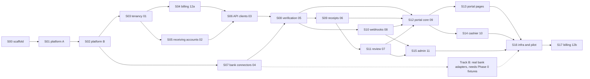

# Build plan for Claude Code

The build order of `docs/00-overview.md` section 7, cut into steps a single Claude Code session can finish and you can review. Each step names what to read, what to build (the `Tnn.m` tasks from the feature docs' Implementation plans), how to know it's done, and the prompt to paste.

## How to run a step

1. Start a fresh Claude Code session in the repo (or `/clear`), so each step begins with a clean context.
2. Paste the step's prompt. It is usually just `/build-step S08`. The `build-step` skill reads the docs, plans, builds, tests, updates `docs/build/progress.md` and commits on `step/S08-…`.
3. When it reports back, run `/check-step S08` in a new session for an independent audit against the docs. Ask Claude to fix any gaps it lists.
4. Review the diff yourself (or open a PR), merge to `main`, then start the next step.
5. If Claude stops with a question, answer it in `docs/build/questions.md` (or in chat) and run the same step again; it picks up from `progress.md`.

Steps that don't depend on each other can run in parallel in separate git worktrees: S07 next to S03–S06, S10 next to S09, S15 next to S12, and S13 next to S14. The critical path is S00 → S01 → S02 → S03 → S05 → S06 → S08 → S09 → S11 → S12 → S13 → S16.

## Phase 0: people's work, in parallel with S00–S07

These come from overview section 8 and can't be done by Claude Code. Track them in `docs/build/progress.md`.

| Item | Why it blocks | Question |
| --- | --- | --- |
| Legal opinion on using each bank's public receipt page; approach banks about official access | Commercial launch | Q1 |
| Accounts at all 7 providers; make small test payments for canaries and fixtures | Track B adapters, canaries | Q2 |
| In-country hosting and two ISPs for bank egress; static IPs for webhook egress | S16 | Q3, 08-Q2 |
| Run the fixture-capture tool (T04.19) from an in-country host against real receipts | Track B | Q15 |
| Vision provider decision (none, self-hosted, or abroad with consent) | Receipt reading quality | Q4 |
| Plans and prices | S17 (the seeds in doc 12 work until then) | Q5 |
| Native Amharic reviewer for every † string | Pilot | Q10 |
| Product name and domains | S16 | Q11 |

---

## S00: Repository scaffold, CI and dev stack

- **Needs:** nothing.
- **Read:** overview §2 (stack), §3.1 (deployables), §4 (folder structure and boundary rules), §5.13 (migrations), §6.7 (testing); `CLAUDE.md` Commands.
- **Build:**
  - pnpm workspace and Turborepo; TypeScript strict base config; ESLint with `eslint-plugin-boundaries` encoding the DAG from overview §3.2 (including the allowed edges listed there); dependency-cruiser (no cycles); Prettier; Vitest workspace with coverage thresholds (`domain/` 90%, package 80%).
  - Package skeletons for the 7 apps and for `libs/platform`, `libs/contracts`, `libs/ui` and the 12 features. Each feature `package.json` exports only `./src/public/index.ts`, plus a `./testing` export for fakes.
  - Docker Compose: Postgres 18 (primary only in dev), Redis 7, MinIO with buckets (`receipts`, `bank-evidence`, `exports`, `kyb`, `invoices`), OpenBao in dev mode with the transit engine, Keycloak with a dev realm import, ClamAV (`clamd`), Mailpit (SMTP sink).
  - Root scripts: `dev`, `build`, `lint`, `typecheck`, `test`, `test:int`, `e2e`, `verify`, `db:migrate`, `db:reset`.
  - `.env.example` with fake values only.
  - GitHub Actions CI running `pnpm verify` on Postgres and Redis service containers.
  - A `hello` sample feature proving the boundary rules; delete it in S03.
- **Done when:**
  - a clean clone runs `pnpm install && docker compose up -d && pnpm verify` green;
  - every Compose service is healthy;
  - lint fixtures prove that a deep import (`@proofline/x/src/...`) and an import against the DAG both fail;
  - CI is green.
- **Prompt:** `/build-step S00`

## S01: Platform kernel A (config, context, errors, IDs, money, clock, logging, database)

- **Needs:** S00.
- **Read:** overview §5.1, §5.2, §5.4, §5.8, §5.9, §5.11, §5.12, §5.13, §5.19 (Clock), §6.1–§6.5; the error-code table in §6.4, including the "codes the feature docs add" table.
- **Build:**
  - `platform/config`: `EnvSchema`, per-feature schema merge, exit 78 on invalid config.
  - `platform/context`: `Ctx` with AsyncLocalStorage and the `Principal` union.
  - `platform/errors`: `AppError`, the HTTP error filter and body shape.
  - `platform/ids`: ULID with prefixes, `toUuid` and `fromUuid`.
  - `platform/money`.
  - `platform/clock`: `Clock` and `FakeClock`.
  - `platform/logging` and `platform/telemetry`: pino with the redaction list, OpenTelemetry setup, Prometheus registry.
  - `platform/db`: `Db.tx()` setting `app.tenant_id`, `app.env` and `app.principal_kind`; statement timeouts; replica option; the migration runner in DAG order as `pl_migrator`; database roles `pl_app`, `pl_admin`, `pl_migrator`; a partition registry helper used by maintenance.
  - `libs/contracts`: `src/errors.ts` with **every** code from overview §6.4 and the feature-doc table; `src/events/` with the shared enums (statuses, reasons, bank codes) and an event-schema registry that the feature steps fill in; the pagination cursor helper.
- **Done when:**
  - unit tests cover money parsing and formatting (including the regex edge cases), ID round-trips and error bodies;
  - an integration test proves RLS isolation by tenant and env on a sample table with `FORCE ROW LEVEL SECURITY`;
  - the migration runner applies feature folders in DAG order;
  - `pnpm verify` is green.
- **Prompt:** `/build-step S01`

## S02: Platform kernel B (crypto, outbox, queues, idempotency, storage, audit, i18n, authz, flags, UI tokens)

- **Needs:** S01.
- **Read:** overview §5.1 (`FeatureFlags`, `FeatureFlagsAdmin`, `ConfigRegistry`), §5.3, §5.5, §5.6 (including `AuditReader`), §5.7 (Ethiopian calendar algorithm and **all 8 test vectors**), §5.10, §5.14–§5.19, §3.6 (queue conventions); `docs/reference/ui-spec.md` "Design direction"; doc 09 §6.2 (status tokens); doc 11 §6.8 (dark tokens).
- **Build:**
  - `platform/crypto` and `platform/pii`: OpenBao transit envelope encryption with a 5-minute data-key cache, HMAC per purpose, masks.
  - `platform/outbox`: `Outbox.publish`, the relay loop (`LISTEN` with a 500 ms poll fallback, `SKIP LOCKED`), `event_inbox`, parking in `outbox_dead` after 10 failures, `@OnEvent`.
  - `platform/queue`: `JobDef`, `Queues.add` and `cancel`, `@Processor`, `WORKER_GROUPS`.
  - `platform/idempotency`.
  - `platform/rate-limit`: token bucket with the `RateLimit-*` headers.
  - `platform/storage`: all 5 buckets.
  - `platform/audit`: writer with the hash chain and advisory lock, `AuditReader`, the daily chain check.
  - `platform/i18n`: `toEthiopian`, `fromEthiopian`, `formatInstant`, `t()`; catalogue folders `libs/contracts/i18n/{en,am}/{common,status,reason,errors,email,portal,cashier,upload,admin}.json`; the parity check script.
  - `platform/notify`: SMTP, sent to Mailpit in dev.
  - `platform/authz`: `RequirePermission`, `RequireScope`, `Public`, the `AccessResolver` port, the boot-time route check.
  - `platform/config` additions: `FeatureFlags`, `FeatureFlagsAdmin`, `ConfigRegistry`.
  - `platform/testing`: Testcontainers helpers, fake factories.
  - The maintenance queue skeleton (retention, chain check, partitions).
  - `libs/ui`: Tailwind tokens (light and the admin dark set), fonts (self-hosted IBM Plex Sans, IBM Plex Mono, Noto Sans Ethiopic), and a token contrast unit test.
- **Done when:**
  - all 8 Ethiopian calendar vectors pass both ways;
  - the outbox delivers at least once and the inbox dedupes, including under a forced relay crash in an integration test;
  - an audit chain break is detected;
  - idempotency replays and conflicts behave as in §5.16;
  - every token pair is at least 4.5:1;
  - the i18n parity check fails on a missing key;
  - `pnpm verify` is green.
- **Prompt:** `/build-step S02`

## S03: Doc 01, tenancy, auth and RBAC (backend)

- **Needs:** S02.
- **Read:** `docs/features/01-tenancy-auth-rbac.md`, every section.
- **Build:** T01.1–T01.16. The screens (T01.17) come in S12, S13 and S15. Delete the `hello` sample from S00.
- **Done when:**
  - staff sign in with Keycloak OIDC and MFA, and tenant users with password and TOTP;
  - RLS tests prove tenant and env isolation;
  - the last-owner concurrency test passes;
  - the full permission matrix is tested against `AccessResolver`;
  - every acceptance criterion of US-01.x has a test;
  - `pnpm verify` is green.
- **Prompt:** `/build-step S03`

## S04: Doc 12a, plans, subscriptions, metering and quota

- **Needs:** S03.
- **Read:** `docs/features/12-billing-usage.md`, sections 1–15, but only the parts marked 12a; overview R12.
- **Build:**
  - T12.1–T12.5;
  - from T12.6, the API parts only: `GET /portal/v1/usage`, `GET /portal/v1/billing/overview` without `upcoming`, `GET /portal/v1/billing/usage/daily`, and the admin `GET` and `POST /tenants/{id}/plan` and `GET /tenants/{id}/usage`.
  - Publish fakes of `QuotaService`, `PlansApi` and `UsageApi` from `./testing`.
- **Done when:**
  - Sandbox is created on `tenant.created`;
  - the quota decision table passes (Growth: the 12,000th check allowed, then blocked; Sandbox blocked at 50; test env always allowed);
  - metering is idempotent under duplicate deliveries;
  - counters reconcile after a Redis flush;
  - the 80, 100 and 120 notices are sent once each;
  - `pnpm verify` is green.
- **Prompt:** `/build-step S04`

## S05: Doc 02, receiving accounts (backend)

- **Needs:** S03.
- **Read:** `docs/features/02-receiving-accounts.md`, every section; overview R14 and Q8–Q9.
- **Build:**
  - T02.1–T02.6, T02.8, T02.9, and `countAwaitingApproval()`.
  - T02.7's controller with a stub-principal contract test; S06 mounts it behind the API-key guard.
  - Screens (T02.10) come in S13 and S15.
- **Done when:**
  - identifier patterns, name normalisation and the receiver decision table are fully tested;
  - test-env accounts auto-verify;
  - two tenants can't both hold a verified identifier (`account_registered_elsewhere`);
  - the reveal endpoint is audited;
  - `pnpm verify` is green.
- **Prompt:** `/build-step S05`

## S06: Doc 03, API clients and request logs (backend)

- **Needs:** S04, S05.
- **Read:** `docs/features/03-api-clients.md`, every section; overview §5.3 and R13–R14.
- **Build:**
  - T03.1–T03.8, including the `subscription.changed` cache drop.
  - Mount `GET /v1/banks` (stubbed until S07) and doc 02's `GET /v1/receiving-accounts`.
  - Screens (T03.9) come in S13.
- **Done when:**
  - the ordered check chain returns the first failing error for each case in doc 03 §5;
  - rotation overlap and revocation take effect at once;
  - the live gate needs KYB-active and a verified account;
  - the rate limit comes from the plan;
  - request logs are masked and partitioned;
  - `pnpm verify` is green.
- **Prompt:** `/build-step S06`

## S07: Doc 04, bank connectors (framework and sandbox)

- **Needs:** S02. It can run in parallel with S03–S06.
- **Read:** `docs/features/04-bank-connectors.md`, every section; overview Q1, Q2 and Q15.
- **Build:**
  - T04.1–T04.9, T04.17, T04.18, T04.19.
  - `SANDBOX_REFERENCES` in `libs/contracts`.
  - Real adapters (T04.10–T04.16) are **Track B**, below.
- **Done when:**
  - the sandbox connector returns every magic reference's documented result for every bank code;
  - CI proves zero egress requests in test env;
  - the breaker state machine passes its table, with `FakeClock`;
  - the egress client passes the pin-accepted, pin-rejected, slow-server and redirect tests;
  - `GET /v1/banks` serves real status;
  - `pnpm verify` is green.
- **Prompt:** `/build-step S07`

## Track B: real bank adapters (B1–B7)

- **Needs:** S07, plus Phase 0 fixtures for that bank captured with T04.19.
- **Read:** doc 04 §6.1 (that bank's row), §6.2–§6.4, §12; the bank's fixtures folder.
- **Build:** one adapter per run, in this order: B1 TELEBIRR, B2 CBE, B3 BOA, B4 DASHEN, B5 CBEBIRR, B6 MPESA, B7 AWASH (T04.10–T04.16). After all seven, run T05.12 (the live path against mock banks, then a Phase 0 smoke test from in-country).
- **Done when:** the parser passes `found`, `not_found` and at least one format-variant fixture; the classification table holds for that bank; the canary reference is configured.
- **Prompt:** `/build-step B1` (then B2, B3, …).

## S08: Doc 05, verification engine

- **Needs:** S06, S07.
- **Read:** `docs/features/05-verification-engine.md`, every section; overview §3.3–§3.5 and R1–R6, R10, R12, R14, R15.
- **Build:**
  - T05.1–T05.11.
  - Doc 06 isn't built yet: use a fake `ReceiptsApi` that matches doc 06 §3 exactly (`stage`, `attachStaged`, `createUploadLink`, `invalidateUploadLinks`, `activeUploadLink`, `attachShareLink`, `latestForVerification`, `getEvidence`, `ensureClaimedFields`). S09 swaps in the real one.
  - Include `getPublicJson`, `count`, `addReceipt` (with the public and portal receipt routes), `revealPayer` (with its routes), `platformStats` and `platformSearch`.
- **Done when:**
  - Flow A works end to end in test env with every sandbox reference;
  - the claim race test passes (two parallel verifications of one reference: exactly one wins);
  - every row of the §6.2 state table has a test;
  - precedence follows R15;
  - `wait_seconds` returns `200` or `202` correctly, including a lost pub/sub message;
  - the sweeper re-enqueues lost attempts;
  - idempotent replays work;
  - `pnpm verify` is green.
- **Prompt:** `/build-step S08`

## S09: Doc 06, receipt intake and the upload page

- **Needs:** S08.
- **Read:** `docs/features/06-receipt-intake.md`, every section; mockups `UploadChoose`, `UploadChooseAm`, `UploadInReview`; overview R10 and Q4.
- **Build:**
  - T06.1–T06.12, including `apps/web-upload`, `activeUploadLink`, `attachShareLink`, the `verification_states` mirror, `token_enc` and the `display` snapshot on links.
  - Replace S08's `ReceiptsApi` fake with the real module in the wiring.
- **Done when:**
  - Flow B works up to `in_review`: upload, extraction, bank retry;
  - magic-byte, ClamAV (fail closed) and sanitising tests pass;
  - QR and PDF-text corpus tests meet their thresholds;
  - the upload page matches the three mockups in EN and AM, is under 150 KB, and LCP is under 2.5 s on throttled 3G in Playwright;
  - `next_action.upload_url` appears in `GET` while a link is active;
  - `pnpm verify` is green.
- **Prompt:** `/build-step S09`

## S10: Doc 08, webhooks (backend)

- **Needs:** S08. It can run in parallel with S09.
- **Read:** `docs/features/08-webhooks.md`, every section; overview §6.6.
- **Build:** T08.1–T08.8 and T08.10. The portal UI (T08.9) comes in S13.
- **Done when:**
  - both signing test vectors pass, and deliveries verify with the official `standardwebhooks` npm and Python libraries;
  - the retry schedule, `Retry-After`, 410 handling, the 72 h disable and the failing and recovered notices pass with `FakeClock`;
  - SSRF tests pass (blocked ranges, DNS rebinding, no redirects);
  - the per-endpoint semaphore caps in-flight attempts at 10;
  - `pnpm verify` is green.
- **Prompt:** `/build-step S10`

## S11: Doc 07, manual review (backend)

- **Needs:** S09.
- **Read:** `docs/features/07-manual-review.md`, every section; overview R7–R9.
- **Build:**
  - T07.1–T07.8, plus `backlog(range)` and `findByNumber(n)`.
  - The admin UI (T07.9) comes in S15 and the portal UI (T07.10) in S13.
- **Done when:**
  - Flow B works end to end in test env with the sandbox reviewer;
  - 10 parallel "Take next" calls get 10 distinct tasks;
  - SLA amber, breach and the Hybrid handoff pass with `FakeClock`;
  - four-eyes is enforced (`same_approver`);
  - a decision racing a bank answer gives `task_closed`;
  - an approved verification reversed by doc 05 marks the task overturned;
  - `pnpm verify` is green.
- **Prompt:** `/build-step S11`

## S12: Doc 09, portal core (shell, Overview, Verify, Verifications, Sandbox) and sign-in screens

- **Needs:** S08, S09, S10, S11. It can start earlier on contract stubs.
- **Read:**
  - `docs/features/09-tenant-portal.md`, every section;
  - doc 01 §2 (sign-up, sign-in, MFA, invitation screens) and §5 (auth routes);
  - mockups `PortalOverview`, `PortalVerify`, `PortalVerifications`;
  - `docs/reference/ui-spec.md` "Tenant portal".
- **Build:** T09.1–T09.13, plus the auth screens from T01.17 (sign-up, verify email, sign-in, MFA enrolment and challenge, forgot and reset password, accept invitation).
- **Done when:**
  - the three mockups are matched at 1440 px in EN, with Amharic screenshots;
  - Verify shows all five result cards with sandbox references;
  - the drawer composes all its parts, and degrades when one part fails;
  - exports produce CSV and XLSX that parse back;
  - the cashier view shows only Verify and My checks;
  - axe reports no serious or critical issues;
  - `pnpm verify` and the S12 Playwright specs are green.
- **Prompt:** `/build-step S12`

## S13: Portal owner pages (Team, Settings, Receiving accounts, API clients, Request logs, Webhooks, Review queue, Billing & usage)

- **Needs:** S12.
- **Read:**
  - doc 01 §2 (Team, Settings) and §5;
  - doc 02 §2 and §5;
  - doc 03 §2 and §5, plus mockup `PortalApiClients`;
  - doc 07 §2 (tenant stage) and §5 (portal);
  - doc 08 §2 and §5;
  - doc 12 §2 (12a parts);
  - `docs/reference/ui-spec.md` "Tenant portal".
- **Build:** the portal parts of T01.17 (Team, Settings), T02.10, T03.9, T07.10, T08.9 and T12.6.
- **Done when:**
  - `PortalApiClients` matches its mockup;
  - each page has its loading, empty and error states in EN and AM;
  - re-auth flows work (key rotation, webhook secret reveal, settings);
  - the Hybrid tenant reviews a task in the portal;
  - `pnpm verify` and the Playwright specs are green.
- **Prompt:** `/build-step S13`

## S14: Doc 10, cashier app (PWA)

- **Needs:** S08, S09, S11, and S12 for the portal shell and auth screens.
- **Read:** `docs/features/10-cashier-app.md`, every section; mockups `CashierScan`, `CashierVerified`, `CashierRejectedAm`; `docs/reference/ui-spec.md` "Mobile verify screen".
- **Build:** T10.1–T10.10.
- **Done when:**
  - the Playwright mobile run with a fake camera feeding a sandbox QR reaches the green screen;
  - `TEST_DUPLICATE` gives the red Amharic screen matching the mockup;
  - the PIN lock is enforced by the server;
  - the service worker never caches `/api/*` (tested);
  - Lighthouse installability passes;
  - `pnpm verify` is green.
- **Prompt:** `/build-step S14`

## S15: Doc 11, admin panel, plus the admin screens of docs 01, 02, 07 and 12a

- **Needs:** S10, S11. It can run in parallel with S12–S14.
- **Read:**
  - `docs/features/11-admin-panel.md`, every section;
  - doc 07 §2 and §5 (admin);
  - doc 01 §2 (Tenants, Staff);
  - doc 02 §2 (admin queue);
  - doc 12 §2 (admin tenant Plan & usage);
  - mockups `Main`, `AdminQueue`, `AdminReview`;
  - `docs/reference/ui-spec.md` "Admin panel".
- **Build:**
  - T11.2–T11.11 (T11.1 was done in S02; check it);
  - T07.9 (Review queue and workspace UI);
  - the admin parts of T01.17 (Tenants, Staff), T02.10 and T12.6.
- **Done when:**
  - the three admin mockups are matched at 1440 px, light and dark;
  - the review workspace works by keyboard alone (A, R, I, E, J, K, N);
  - forcing a breaker open shows a Down tile and an alert within 30 s;
  - the audit log shows the chain badge;
  - the allowlist guard is tested;
  - `pnpm verify` and the Playwright specs are green.
- **Prompt:** `/build-step S15`

## S16: Infrastructure, observability and pilot readiness

- **Needs:** S13, S14, S15. Track B is needed for live banks.
- **Read:** overview §3.1, §3.6, §3.8 and §8 (Q3, Q11, Q13, Q14); every feature doc's §11 (Performance), §13 (Observability) and §14 (Configuration); doc 04 §6.6 and §10; doc 08 §6.8.
- **Build:**
  - Dockerfiles per app and Helm charts for k3s with `WORKER_GROUPS` pod sets.
  - Squid configs: the two bank egress nodes (allowlist of the adapters' hosts) and the webhook egress (deny private ranges, `CONNECT` to 443 and 1024–65535).
  - The OpenBao policies and transit keys; the Keycloak realm with WebAuthn and TOTP required.
  - Postgres primary and replica with backups and a restore drill; MinIO lifecycle rules.
  - Grafana dashboards and Prometheus alert rules for every metric and alert in the docs' §13; Loki, Tempo and GlitchTip.
  - Runbooks in `docs/runbooks/`: bank down, breaker stuck, format changed, outbox lag, webhook egress down, audit chain break, key rotation, restore.
  - A k6 load test against the §3.8 targets.
  - An OWASP ASVS L2 checklist pass; DPIA inputs (data map from every doc's §10).
- **Done when:**
  - a staging deploy passes the full Playwright suite;
  - the load test meets §3.8 (API overhead p95 under 150 ms; webhook first delivery p95 under 60 s);
  - every alert has a runbook;
  - the restore drill is documented;
  - the pilot gate checklist below is signed off.
- **Prompt:** `/build-step S16`

**Pilot gate** (from the architecture doc):

- Phase 0 answers recorded for Q1–Q4, Q10 and Q11.
- All 7 adapters live with canaries green for 7 days.
- An external pen test with no high findings open.
- Registration with the data protection authority.
- Amharic reviewed.
- Runbooks rehearsed.

## S17: Doc 12b, invoices, payments, dunning and self-service plans

- **Needs:** S16 and the pilot (overview §7).
- **Read:** `docs/features/12-billing-usage.md`, the 12b parts (§2 US-12.7–12.14, §4 tables in `0004`, §5, §6.5–§6.9); overview Q5; doc 12 Open Questions 12-Q2 (fiscal) and 12-Q3.
- **Build:** T12.7–T12.12.
- **Done when:**
  - the invoice builder passes the proration and VAT examples;
  - numbering stays gapless under 20 parallel issuers;
  - a sandbox payment through the house API confirms, rejects and reviews as specified;
  - dunning suspends and reactivates;
  - bilingual PDFs render with both calendars;
  - an accountant has reviewed the invoice layout (12-Q2) before the paid-launch gate;
  - `pnpm verify` is green.
- **Prompt:** `/build-step S17`

---

## If you're not using the skills

Any step can be run with this prompt instead of `/build-step`:

> Implement step SNN of docs/build/plan.md. Follow CLAUDE.md. First read every doc section the step lists under "Read" and the mockups it names, check docs/build/progress.md for its "Needs", then make a task list from its "Build" items. Write tests from the docs' acceptance criteria first, implement, and run pnpm verify until green. Don't guess any rule: log unclear points in docs/build/questions.md and use the doc's default, or ask me if there is none. When done, tick every "Done when" item with evidence, update docs/build/progress.md, and commit on branch step/SNN-<slug>. Don't push.

And for the audit:

> Audit step SNN against its docs using the checklist in .claude/skills/check-step/SKILL.md. Read-only: report a table of gaps with doc references and fixes, and don't change code.
