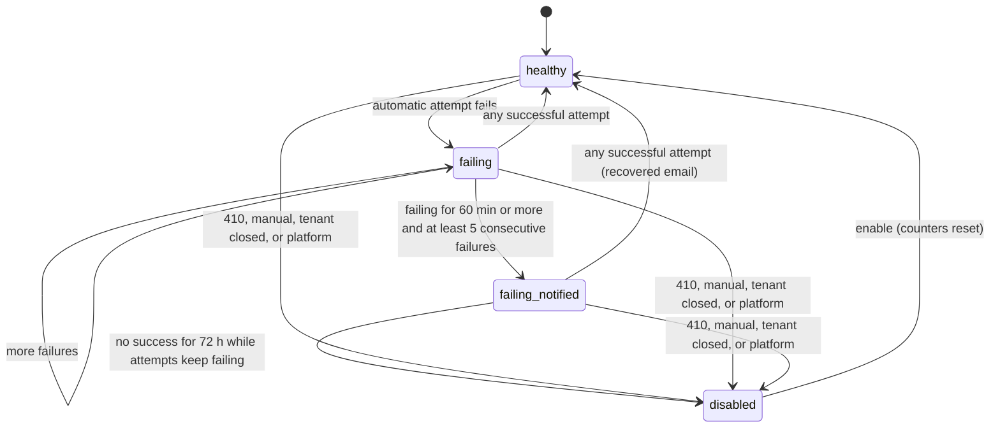

# 08 · Webhooks

| | |
| --- | --- |
| Package | `@proofline/webhooks` |
| Postgres schema | `webhooks` |
| Depends on | platform, 01 tenancy, 05 verification (`getPublicJson` only; adds the edge `webhooks → verification` to the overview DAG) |
| Build step | 6 (in parallel with 06) |
| Mockups | Portal · Verifications drawer ("Resend webhook" button; timeline line "Webhook verification.rejected delivered · 200 in 140 ms"); Portal · API clients note ("Listen for the verification.* webhooks…"); the portal sidebar's "Webhooks" item. The Webhooks pages themselves are not drawn |

## 1. Purpose and scope

**Does**

- Turns each public verification status change into one signed webhook event, and delivers it to every subscribed endpoint in the tenant's environment.
- Manages endpoints: URL validation, event filters, signing secrets with a rotation overlap, enable, disable and delete.
- Delivers with [Standard Webhooks](https://www.standardwebhooks.com/) signatures (overview 6.6). Failed deliveries are retried 10 times over about 24 hours. A per-endpoint concurrency cap, SSRF protection and fixed source IPs apply to every delivery.
- Tracks endpoint health: a failing notice after 1 hour, automatic disabling on `410 Gone` or after 72 hours of failures, and a recovery notice.
- Keeps a 30-day log of events, deliveries and attempts for the portal, with resend, replay and test events.

**Out of scope**

- Deciding statuses (doc 05). This module only reacts to `verification.status_changed`.
- Sending email. That goes through the platform `Notify`; this module only chooses recipients and templates.
- Managing endpoints through the public API. The portal is the only surface at launch (open question 08-Q1).
- Event types other than the verification set and `webhook.test`. The catalogue is additive (overview 6.2).

## 2. Screens and user stories

| Screen | Surface | Mockup |
| --- | --- | --- |
| Webhooks: endpoint list, with Events and Source IPs | Portal | Not drawn. Reached from the sidebar's "Webhooks" item; built from `libs/ui` `DataTable`, `DetailDrawer` and `StatusBadge` |
| Add or edit endpoint dialog; "Signing secret" dialog (after create, rotate or reveal) | Portal | Not drawn |
| Endpoint detail: settings, signing secret, health, deliveries table | Portal | Not drawn |
| Delivery drawer: request, attempts, response excerpt, Resend | Portal | Not drawn |
| Webhook lines in the verification timeline; "Resend webhook" | Portal | Portal · Verifications (drawer) |
| Tenant webhooks (read-only health, disable) | Admin | Not drawn; a section on the admin tenant page (doc 11) |

**Layout of the undrawn pages.** These follow the portal's existing table and drawer pattern.

- **Endpoint list columns:** URL (host bold, path muted), Description, Events ("All events" or a count), Status (`Enabled` green; `Failing since 10:42` amber; `Disabled · Endpoint returned 410` grey), Success (24 h), Last delivery.
- **Header actions:** "Add endpoint" (needs `webhooks.manage`). The Live/Test switch applies as on every portal page.
- **Empty state:** "No endpoints yet. Add one to receive verification results as they happen." A link to the integration guide sits under it.
- **Source IPs callout:** "Deliveries come from these IP addresses: …", with a copy button, so merchants can allowlist them.
- **Endpoint detail tabs:** Overview (health, settings, signing secret), Deliveries, Replays.
- **Delivery drawer:** the event type and ID, the verification link, the endpoint URL, the request headers (signature truncated to 12 characters), the pretty-printed body, then one card per attempt (time, trigger, outcome, status code, duration, response excerpt) and a "Resend" button.

**US-08.1 Add an endpoint**

- Given a user with `webhooks.manage` who re-authenticated in the last 5 minutes enters an `https` URL, an optional description (at most 200 characters) and event types (default "All events"),
- when they save, then the endpoint is created `enabled` (`201`), and a dialog shows the signing secret `whsec_…` once, with Copy and "I've saved it";
- and afterwards the list shows only the secret's hint (`whsec_…xY7a`). The full secret is shown again only through "Reveal secret" (US-08.12).

**US-08.2 URL rules**

- A URL that is not `https`, has an IP-literal host, uses `localhost` or a private suffix, carries `user:pass@`, uses a port other than 443 or 1024–65535, is longer than 2,048 characters, or resolves to a blocked address is refused with `422 invalid_webhook_url`.
- `details.reason` is one of `scheme`, `host`, `port`, `userinfo`, `length`, `unresolvable` or `blocked_address`, and the form shows the matching message.

**US-08.3 Endpoint limit**

- The 11th non-deleted endpoint in one tenant and env returns `422 webhook_endpoint_limit_reached`.

**US-08.4 Event built**

- When a verification moves to `verified`, `rejected`, `receipt_required`, `in_review`, `reversed`, `expired` or `cancelled`, exactly one event `verification.<status>` is stored, within 2 s at p95 of the transition.
- One delivery is created per enabled endpoint in that env whose event filter includes the type.
- A move to `processing` creates no event. An event is stored even if the tenant has no endpoints, so it can be replayed later.

**US-08.5 Delivered**

- The endpoint receives a `POST` with the headers in section 5.4. The `standardwebhooks` library verifies the signature with the endpoint's secret.
- A `2xx` response within 10 s marks the delivery `succeeded`.
- The verification drawer's timeline shows "Webhook verification.verified delivered · 200 in 140 ms".

**US-08.6 Retried**

- A non-`2xx` response (other than 410), a timeout or a connection error schedules the next attempt per section 6.3.
- After the 10th automatic attempt fails, the delivery is `failed`, and the drawer shows "Failed after 10 attempts". The timeline line reads "Webhook verification.verified failed · 503".

**US-08.7 Retry-After**

- A `429` or `503` with `Retry-After: 120` delays the next attempt by at least 120 s, even when the schedule says 5 s. `Retry-After` never pushes an attempt past 8 hours.

**US-08.8 Gone**

- A `410` response disables the endpoint immediately, with reason `gone`.
- Its pending deliveries are cancelled, and the tenant receives the "Endpoint disabled" email.

**US-08.9 Failing notice and recovery**

- When an endpoint has failed every automatic attempt for at least 60 minutes and at least 5 in a row, the alert recipients get one "Webhook endpoint failing" email, and the list shows `Failing since 10:42`.
- The first successful attempt afterwards clears the state and sends one "Webhook endpoint recovered" email.

**US-08.10 Auto-disable**

- When an endpoint has had no successful attempt for 72 hours while attempts kept failing, it is disabled with reason `failing`, pending deliveries are cancelled, and the "Endpoint disabled" email is sent.

**US-08.11 Re-enable and catch up**

- "Enable" sets the endpoint `enabled` and resets its health.
- The dialog then offers "Replay events you missed", with the range prefilled from `disabled_at` to now (capped to 7 days).

**US-08.12 Rotate the secret**

- "Rotate secret" needs a re-authentication within 5 minutes. It shows the new secret once.
- For 24 hours every delivery carries two signatures, one per secret, so the receiver can switch without downtime.
- "Expire previous secret now" ends the overlap early. A rotation while two secrets are already active returns `409 invalid_state`.
- "Reveal secret" shows the current secret after a re-authentication within 5 minutes, as the UI spec asks. Each reveal is audited (`webhook.secret_revealed`).

**US-08.13 Test event**

- "Send test event" delivers a `webhook.test` event to that endpoint only.
- Within 12 s the dialog shows the outcome, status code, duration and the first 1 KB of the response. If the attempt takes longer, it shows "Still sending…" and polls the delivery.
- At most 10 test events per endpoint per minute (`429 rate_limited`).

**US-08.14 Resend from the verification drawer**

- "Resend webhook" sends the verification's latest event again to every enabled endpoint subscribed to its type, as one manual attempt each, and shows "Resent to 2 endpoints".
- The button is disabled with a tooltip when the verification has no event yet ("No webhook has been sent for this verification yet") or the env has no enabled endpoint ("Add a webhook endpoint first").
- At most 5 resends per verification per minute.

**US-08.15 Resend one delivery**

- "Resend" in the delivery drawer makes one manual attempt on that delivery, with the same `webhook-id` and body.
- It is refused with `409 invalid_state` while an attempt is in flight or when the endpoint is disabled or deleted.

**US-08.16 Replay**

- "Replay" takes a range of at most 7 days inside the last 30. It queues one manual attempt for every event in the range that matches the endpoint's filter and has no successful delivery to that endpoint.
- The Replays tab shows matched and queued counts until it finishes.
- Only one replay runs per endpoint (`409 replay_in_progress`). A range matching more than 10,000 events returns `400 invalid_field` with `details.matched`.

**US-08.17 Delivery log**

- The Deliveries tab filters by status (`pending`, `succeeded`, `failed`, `cancelled`), event type, verification ID and time.
- Rows older than 30 days are gone. Opening a delivery shows the exact body that was signed and sent.

**US-08.18 Live and test**

- Test-env events go only to test-env endpoints and carry `livemode: false`. The Live/Test switch shows separate endpoint lists, and a live endpoint never receives a test event.

**US-08.19 Tenant closed**

- When the tenant becomes `closed`, every endpoint is disabled with reason `tenant_closed`, pending deliveries are cancelled, and "Enable" returns `409 invalid_state`.

**US-08.20 Admin view**

- A platform user with `platform.tenants.read` sees the tenant's endpoints: URL with query values masked, status, health and 24 h success rate, plus the last 50 deliveries' metadata.
- Payloads and response bodies are never shown to staff.
- A platform Admin (`platform.tenants.manage`) can disable an endpoint with a reason, which is audited.

## 3. Module design

```text
libs/features/webhooks/src/
├─ public/
│  ├─ index.ts                   WebhooksModule, WebhooksApi, PUBLIC_EVENT_TYPES, event types
│  ├─ webhooks-api.ts
│  └─ events.ts
├─ domain/
│  ├─ event-catalogue.ts         status → public type; envelope builder (pure)
│  ├─ signing.ts                 sign(), generateSecret(), secretHint() (pure, node:crypto only)
│  ├─ schedule.ts                retry delays, jitter, Retry-After parsing (pure)
│  ├─ url-policy.ts              syntax rules and blocked address ranges (pure)
│  ├─ classify.ts                attempt result → outcome (pure)
│  ├─ endpoint-health.ts         health transitions and effects (pure)
│  └─ delivery-state.ts          delivery transitions (pure)
├─ application/
│  ├─ event-builder.handler.ts   @OnEvent verification.status_changed
│  ├─ tenant-status.handler.ts   @OnEvent tenant.status_changed (closed → disable all)
│  ├─ notifier.handler.ts        @OnEvent webhook.endpoint_failing / _disabled / _recovered → Notify.email
│  ├─ endpoints.service.ts       create, update, enable, disable, delete, rotate, expire previous
│  ├─ delivery.processor.ts      queue webhook-deliver, jobs whd:*
│  ├─ replay.processor.ts        queue webhook-deliver, jobs whr:*
│  ├─ sweeper.processor.ts       repeatable whs:sweep every 30 s
│  ├─ manual.service.ts          test event, resend delivery, resend for verification
│  └─ query.service.ts           lists, detail, health, stats
├─ infrastructure/
│  ├─ safe-http-client.ts        DNS pinning, blocked ranges, egress proxy, timeouts, size cap
│  ├─ semaphore.ts               per-endpoint in-flight cap (Redis sorted set plus Lua)
│  ├─ endpoints.repo.ts, secrets.repo.ts, events.repo.ts, deliveries.repo.ts, attempts.repo.ts, replays.repo.ts
│  └─ pubsub.ts                  publish whd:{deliveryId} after each attempt commits (test-event waiter)
├─ http/
│  ├─ portal/webhooks.controller.ts      /portal/v1/webhooks/*
│  └─ admin/webhooks.controller.ts       /admin/v1/tenants/{tenantId}/webhooks/*
└─ db/schema.ts, db/migrations/
```

```ts
// public/webhooks-api.ts
export const PUBLIC_EVENT_TYPES = [
  'verification.verified', 'verification.rejected', 'verification.receipt_required', 'verification.in_review',
  'verification.reversed', 'verification.expired', 'verification.cancelled',
] as const;
export type PublicEventType = (typeof PUBLIC_EVENT_TYPES)[number];
export type DeliveryStatus = 'pending' | 'succeeded' | 'failed' | 'cancelled';

export interface WebhooksApi {
  /** Portal drawer timeline (doc 09) and admin verification detail (doc 11). Newest first. */
  deliveriesForVerification(verificationId: string, scope: { tenantId: string; env: EnvName }): Promise<VerificationDeliveryLine[]>;
  /** Portal overview card (doc 09) and admin tenant page (doc 11). Cached 60 s. */
  health(tenantId: string, env: EnvName): Promise<WebhookHealth>;
}
export interface VerificationDeliveryLine {
  deliveryId: string; eventId: string; eventType: PublicEventType; endpointId: string; endpointUrlMasked: string;
  status: DeliveryStatus; attempts: number; lastStatusCode: number | null; lastDurationMs: number | null;
  lastAttemptAt: Date | null; nextAttemptAt: Date | null; succeededAt: Date | null;
}
export interface WebhookHealth {
  endpoints: number; enabled: number; failing: number; disabled: number;
  successRate24h: number | null;            // automatic attempts only; null when there were none
  oldestFailingSince: Date | null;
}
```

```ts
// domain/signing.ts
/** Standard Webhooks v1. signed content = `${msgId}.${timestamp}.${body}`; key = base64-decoded secret without "whsec_".
 *  Returns "v1,<b64>" or, with two secrets, "v1,<b64> v1,<b64>" (newest secret first). */
export function sign(input: { msgId: string; timestamp: number; body: string; secrets: string[] }): string;
/** "whsec_" + base64(32 random bytes). */
export function generateSecret(): string;
export function secretHint(secret: string): string;   // "whsec_…" + last 4 characters

// domain/schedule.ts
export const DEFAULT_RETRY_SCHEDULE_S = [0, 5, 60, 300, 1800, 3600, 7200, 14400, 28800, 28800] as const;
/** attemptNo is the automatic attempt that just failed (1-based). Returns null when none is left. */
export function nextDelayMs(attemptNo: number, retryAfterS: number | null, rand: () => number): number | null;
export function parseRetryAfter(header: string | null, now: Date): number | null;   // delta-seconds or HTTP-date; else null

// domain/classify.ts
export type AttemptOutcome = 'success' | 'http_error' | 'gone' | 'timeout' | 'connect_error' | 'tls_error'
  | 'dns_error' | 'blocked_address' | 'redirect';

// infrastructure/safe-http-client.ts
export interface SafeHttpClient {
  post(url: string, body: string, headers: Record<string, string>): Promise<SafeHttpResult>;
}
export type SafeHttpResult =
  | { kind: 'response'; status: number; headers: Record<string, string>; bodyExcerpt: Buffer; durationMs: number; remoteIp: string }
  | { kind: 'error'; outcome: Exclude<AttemptOutcome, 'success' | 'http_error' | 'gone' | 'redirect'>; detail: string; durationMs: number };
```

## 4. Data model

```sql
CREATE TABLE webhooks.endpoints (
  id                    uuid PRIMARY KEY,
  tenant_id             uuid NOT NULL REFERENCES tenancy.tenants(id),
  env                   text NOT NULL CHECK (env IN ('live','test')),
  url                   text NOT NULL CHECK (length(url) <= 2048),
  url_host              text NOT NULL,
  description           text NULL CHECK (length(description) <= 200),
  event_types           text[] NULL CHECK (event_types IS NULL OR (cardinality(event_types) BETWEEN 1 AND 7
                          AND event_types <@ ARRAY['verification.verified','verification.rejected','verification.receipt_required',
                          'verification.in_review','verification.reversed','verification.expired','verification.cancelled']::text[])),
                                                   -- NULL = all public types, including types added later
  status                text NOT NULL DEFAULT 'enabled' CHECK (status IN ('enabled','disabled')),
  disabled_reason       text NULL CHECK (disabled_reason IN ('manual','gone','failing','tenant_closed','platform')),
  disabled_at           timestamptz NULL,
  failing_since         timestamptz NULL,          -- first failed automatic attempt since the last success
  consecutive_failures  integer NOT NULL DEFAULT 0,
  failing_notified_at   timestamptz NULL,
  last_success_at       timestamptz NULL,
  last_failure_at       timestamptz NULL,
  created_by_user_id    uuid NULL,
  created_at            timestamptz NOT NULL DEFAULT now(),
  updated_at            timestamptz NOT NULL DEFAULT now(),
  deleted_at            timestamptz NULL,          -- soft delete keeps the URL for the 30-day log
  version               integer NOT NULL DEFAULT 0
);
CREATE INDEX endpoints_tenant ON webhooks.endpoints (tenant_id, env) WHERE deleted_at IS NULL;

CREATE TABLE webhooks.endpoint_secrets (
  id                 uuid PRIMARY KEY,
  endpoint_id        uuid NOT NULL REFERENCES webhooks.endpoints(id),
  tenant_id          uuid NOT NULL,
  env                text NOT NULL,
  secret_enc         text NOT NULL,                -- Crypto.encrypt(tenantId, "whsec_…")
  hint               text NOT NULL,                -- "whsec_…xY7a"
  created_at         timestamptz NOT NULL DEFAULT now(),
  expires_at         timestamptz NULL,             -- set when a rotation supersedes it
  created_by_user_id uuid NULL
);
CREATE UNIQUE INDEX endpoint_secrets_one_current ON webhooks.endpoint_secrets (endpoint_id) WHERE expires_at IS NULL;

-- Events, deliveries and attempts are range-partitioned daily on the event's time, so all three drop together.
CREATE TABLE webhooks.events (
  id                uuid NOT NULL,                 -- = the outbox id of the verification.status_changed event; new ULID for webhook.test
  created_at        timestamptz NOT NULL,          -- = ULID time of id
  tenant_id         uuid NOT NULL REFERENCES tenancy.tenants(id),
  env               text NOT NULL,
  type              text NOT NULL,                 -- a PUBLIC_EVENT_TYPES value or 'webhook.test'
  verification_id   uuid NULL,
  payload_enc       text NOT NULL,                 -- Crypto.encrypt(tenantId, exact body bytes)
  payload_sha256    bytea NOT NULL,
  payload_bytes     integer NOT NULL CHECK (payload_bytes <= 262144),
  PRIMARY KEY (id, created_at)
) PARTITION BY RANGE (created_at);
CREATE INDEX events_tenant_time ON webhooks.events (tenant_id, env, created_at DESC, id);
CREATE INDEX events_verification ON webhooks.events (verification_id, created_at DESC) WHERE verification_id IS NOT NULL;

CREATE TABLE webhooks.deliveries (
  id                uuid NOT NULL,
  event_created_at  timestamptz NOT NULL,
  event_id          uuid NOT NULL,
  endpoint_id       uuid NOT NULL,
  tenant_id         uuid NOT NULL,
  env               text NOT NULL,
  event_type        text NOT NULL,
  verification_id   uuid NULL,
  origin            text NOT NULL CHECK (origin IN ('event','test','replay')),
  status            text NOT NULL CHECK (status IN ('pending','succeeded','failed','cancelled')),
  cancel_reason     text NULL CHECK (cancel_reason IN ('endpoint_disabled','endpoint_deleted','tenant_closed')),
  auto_attempts     smallint NOT NULL DEFAULT 0,
  attempt_count     smallint NOT NULL DEFAULT 0,   -- automatic plus manual
  in_flight_until   timestamptz NULL,              -- set while an attempt runs; guards manual resends
  next_attempt_at   timestamptz NULL,              -- automatic schedule; NULL when not pending
  last_attempt_at   timestamptz NULL,
  last_outcome      text NULL,
  last_status_code  smallint NULL,
  last_duration_ms  integer NULL,
  succeeded_at      timestamptz NULL,
  created_at        timestamptz NOT NULL DEFAULT now(),
  updated_at        timestamptz NOT NULL DEFAULT now(),
  PRIMARY KEY (id, event_created_at),
  UNIQUE (event_id, endpoint_id, event_created_at)
) PARTITION BY RANGE (event_created_at);
CREATE INDEX deliveries_endpoint ON webhooks.deliveries (endpoint_id, event_created_at DESC, id);
CREATE INDEX deliveries_verification ON webhooks.deliveries (verification_id) WHERE verification_id IS NOT NULL;
CREATE INDEX deliveries_due ON webhooks.deliveries (next_attempt_at) WHERE status = 'pending';

CREATE TABLE webhooks.delivery_attempts (
  id                uuid NOT NULL,
  event_created_at  timestamptz NOT NULL,
  delivery_id       uuid NOT NULL,
  endpoint_id       uuid NOT NULL,
  tenant_id         uuid NOT NULL,
  env               text NOT NULL,
  attempt_no        smallint NOT NULL,             -- 1.. across all triggers
  trigger           text NOT NULL CHECK (trigger IN ('auto','manual','replay','test')),
  started_at        timestamptz NOT NULL,
  duration_ms       integer NOT NULL,
  outcome           text NOT NULL CHECK (outcome IN ('success','http_error','gone','timeout','connect_error','tls_error',
                      'dns_error','blocked_address','redirect')),
  status_code       smallint NULL,
  remote_ip         inet NULL,
  error_detail      text NULL CHECK (length(error_detail) <= 300),   -- no URL query strings, no body content
  response_headers  jsonb NULL,                    -- only content-type, content-length, retry-after, location
  response_body_enc text NULL,                     -- first 1,024 bytes, Crypto.encrypt(tenantId, …)
  secret_ids        uuid[] NOT NULL,               -- which secrets signed this attempt
  PRIMARY KEY (id, event_created_at),
  UNIQUE (delivery_id, attempt_no, event_created_at)
) PARTITION BY RANGE (event_created_at);
CREATE INDEX attempts_endpoint_time ON webhooks.delivery_attempts (endpoint_id, started_at DESC);

CREATE TABLE webhooks.replays (
  id                   uuid PRIMARY KEY,
  endpoint_id          uuid NOT NULL REFERENCES webhooks.endpoints(id),
  tenant_id            uuid NOT NULL,
  env                  text NOT NULL,
  range_start          timestamptz NOT NULL,
  range_end            timestamptz NOT NULL CHECK (range_end > range_start),
  status               text NOT NULL CHECK (status IN ('running','done','failed','cancelled')),
  matched              integer NOT NULL,
  queued               integer NOT NULL DEFAULT 0,
  requested_by_user_id uuid NOT NULL,
  created_at           timestamptz NOT NULL DEFAULT now(),
  finished_at          timestamptz NULL
);
CREATE UNIQUE INDEX replays_one_running ON webhooks.replays (endpoint_id) WHERE status = 'running';
```

- **RLS:** the standard tenant and env policy (overview 5.4) on every table. The admin tenant page reads through `pl_admin`'s cross-tenant `SELECT`; the one admin write (disable) runs in a transaction scoped to that tenant.
- **Partitions:** the `maintenance` job (04:00 EAT) creates daily partitions 7 days ahead for `events`, `deliveries` and `delivery_attempts`. It drops partitions whose upper bound is older than `WEBHOOKS_RETENTION_DAYS` (30). Replays never reach past the retention window, so nothing points at a dropped row.
- **Lookups by public ID:** `evt_` IDs carry their own time, so the partition is known. `whd_` delivery IDs don't, so detail lookups probe the 30 partitions' primary-key indexes (cheap), and job data always carries `eventCreatedAt`.
- **Migration:** `0001_webhooks_init.sql`.

## 5. API contracts

### 5.1 Portal (`/portal/v1/webhooks`)

All routes run in the session's tenant and env. Lists use cursor paging (overview 6.5).

| Method and path | Permission | Request | Success | Errors |
| --- | --- | --- | --- | --- |
| `GET /endpoints` | `webhooks.read` | none | `200 { data: Endpoint[], source_ips: string[] }` | none |
| `POST /endpoints` | `webhooks.manage`, plus re-auth | `{ url, description?, event_types? }` (`null` or omitted = all) | `201 { endpoint: Endpoint, secret: "whsec_…" }` | `400 invalid_field`; `401 reauth_required`; `422 invalid_webhook_url`; `422 webhook_endpoint_limit_reached` |
| `GET /endpoints/{id}` | `webhooks.read` | none | `200 Endpoint` | `404` |
| `PATCH /endpoints/{id}` | `webhooks.manage`; re-auth when `url` changes | `{ url?, description?, event_types? }` | `200 Endpoint` | `401 reauth_required`; `422 invalid_webhook_url`; `409 invalid_state` (deleted) |
| `POST /endpoints/{id}/disable` | `webhooks.manage` | none | `200 Endpoint` (reason `manual`) | `409 invalid_state` (already disabled) |
| `POST /endpoints/{id}/enable` | `webhooks.manage` | none | `200 Endpoint` | `409 invalid_state` (enabled, deleted, or reason `tenant_closed` or `platform`) |
| `DELETE /endpoints/{id}` | `webhooks.manage` | none | `204` | none |
| `POST /endpoints/{id}/rotate-secret` | `webhooks.manage`, plus re-auth | none | `200 { secret: "whsec_…", previous_expires_at }` | `401 reauth_required`; `409 invalid_state` (two secrets active) |
| `GET /endpoints/{id}/secret` | `webhooks.manage`, plus re-auth | none | `200 { secret: "whsec_…", created_at }`; audited `webhook.secret_revealed` | `401 reauth_required` |
| `POST /endpoints/{id}/expire-previous-secret` | `webhooks.manage`, plus re-auth | none | `200 Endpoint` | `409 invalid_state` (no previous secret) |
| `POST /endpoints/{id}/test` | `webhooks.manage` | none | `200 AttemptView` (finished within 12 s) or `202 { delivery_id }` | `409 invalid_state` (disabled); `429 rate_limited` |
| `GET /endpoints/{id}/deliveries` | `webhooks.read` | `?status&event_type&verification_id&created_gte&created_lt&cursor&limit` | `200 Page<DeliveryRow>` | `400 invalid_field` |
| `GET /deliveries?verification_id=` | `webhooks.read` | Required `verification_id` | `200 { data: VerificationDeliveryLine[] }` (the drawer timeline) | `400 missing_field` |
| `GET /deliveries/{id}` | `webhooks.read` | none | `200 DeliveryDetail` | `404` |
| `POST /deliveries/{id}/resend` | `webhooks.manage` | none | `202 { attempt_no }` | `409 invalid_state` (`details.reason`: `in_flight`, `endpoint_disabled`, `endpoint_deleted`); `429 rate_limited` |
| `POST /verifications/{verification_id}/resend` | `webhooks.manage` | none | `202 { queued: number, event_id }` | `409 invalid_state` (`details.reason`: `no_event`, `no_endpoints`); `429 rate_limited` |
| `GET /events` | `webhooks.read` | `?type&verification_id&created_gte&created_lt&cursor&limit` | `200 Page<EventRow>` | `400 invalid_field` |
| `GET /events/{id}` | `webhooks.read` | none | `200 { event: EventEnvelope, deliveries: DeliveryRow[] }` | `404` |
| `POST /endpoints/{id}/replays` | `webhooks.manage` | `{ since, until }` | `202 Replay` | `400 invalid_field` (range rules, `details.matched` when over 10,000); `409 replay_in_progress`; `409 invalid_state` (disabled) |
| `GET /endpoints/{id}/replays` | `webhooks.read` | `?cursor` | `200 Page<Replay>` | none |
| `GET /event-types` | `webhooks.read` | none | `200 [{ type, label_key }]` | none |

```json
// Endpoint
{
  "id": "whe_01JB7Q2D4F6H8K0M2P4R6T8V0X",
  "livemode": true,
  "url": "https://shop.example.et/hooks/payments",
  "description": "Order service",
  "event_types": null,
  "status": "enabled",
  "disabled_reason": null,
  "disabled_at": null,
  "health": { "state": "healthy", "failing_since": null, "consecutive_failures": 0,
              "last_success_at": "2026-10-04T10:13:03+03:00", "success_rate_24h": 0.998, "deliveries_24h": 1204 },
  "secrets": [ { "hint": "whsec_…xY7a", "created_at": "2026-09-20T09:00:00+03:00", "expires_at": null } ],
  "created_at": "2026-09-20T09:00:00+03:00",
  "updated_at": "2026-10-04T10:13:03+03:00"
}
```

`health.state` is `healthy`, `failing` (`failing_since` set) or `disabled`. `DeliveryDetail` has `delivery`, `endpoint` (`id`, `url`), `event` (the envelope in section 5.3, decrypted), `request_headers` (with the signature cut to 12 characters plus `…`), and `attempts[]`. Each attempt carries `attempt_no`, `trigger`, `started_at`, `duration_ms`, `outcome`, `status_code`, `error_detail` and `response_excerpt` (UTF-8, invalid bytes replaced).

### 5.2 Admin (`/admin/v1/tenants/{tenant_id}/webhooks`)

| Method and path | Permission | Notes |
| --- | --- | --- |
| `GET /endpoints?env=live\|test` | `platform.tenants.read` | Endpoints with `url_masked` (query values replaced by `•••`), status, health, success rate. No secrets or hints |
| `GET /deliveries?env&endpoint_id&status&cursor` | `platform.tenants.read` | At most the last 50 per page, metadata only: event type, status, attempts, last status code, times. No payloads and no response bodies |
| `POST /endpoints/{id}/disable` | `platform.tenants.manage` | `{ reason }` (3–500 characters). Sets `disabled_reason = platform`; the tenant can't re-enable it until staff do. Audited `webhook.endpoint_disabled_by_platform` |
| `POST /endpoints/{id}/enable` | `platform.tenants.manage` | Only for reason `platform`. Audited |

### 5.3 What a merchant receives

Every delivery is a `POST` with this envelope, serialised once as compact JSON when the event is built. Every attempt sends the identical bytes.

```json
{
  "id": "evt_01JB7Q9XKZ3M5N7P9R1T3V5X7Z",
  "type": "verification.verified",
  "api_version": "v1",
  "created_at": "2026-10-04T10:13:02+03:00",
  "livemode": true,
  "transition": {
    "from": "processing", "to": "verified", "reason": null, "review_reason": null,
    "assurance": "bank_confirmed", "at": "2026-10-04T10:13:02+03:00"
  },
  "data": { "id": "ver_01JB7Q8K2M4N6P8R0T2V4X6Z8A", "livemode": true, "status": "verified", "…": "exactly the GET /v1/verifications/{id} object (doc 05, section 5)" }
}
```

- `transition` is copied from the `verification.status_changed` event, so it states exactly what happened.
- `data` is the verification as it was when the event was built (normally under 2 s after the transition). If the verification moved on in that gap, `data.status` can be newer than `transition.to`. Integrators are told to act on `data.status` and to keep the newest `data.updated_at` (section 6.11).
- For `verification.receipt_required`, `data.next_action.upload_url` carries the active upload link, so merchants can forward it to the customer (doc 05 builds `next_action` from doc 06's active link).
- `webhook.test` has `transition: null` and `data: { "message": "Test event", "endpoint_id": "whe_…" }`.
- OpenAPI 3.1 documents these under the top-level `webhooks` key, one entry per event type, generated from the same zod schemas.

### 5.4 Request headers and signature

```http
POST /hooks/payments HTTP/1.1
Host: shop.example.et
Content-Type: application/json
User-Agent: Proofline-Webhooks/1
webhook-id: evt_01JB7Q9XKZ3M5N7P9R1T3V5X7Z
webhook-timestamp: 1791097982
webhook-signature: v1,1tY7nd9t4ydKsOYPQ5PZ+SckgGgS4dW3jYT+LGiJYxs=
```

- `webhook-id` is the event ID. It is the same on every attempt, every resend and every endpoint, so receivers can dedupe on it.
- `webhook-timestamp` is the Unix time in seconds of *this attempt*. Each attempt is re-signed.
- `webhook-signature` holds one `v1,<base64>` per active secret, newest first, separated by a space.

Test vectors (CI runs both):

| Secret | `webhook-id` | Timestamp | Body | Signature |
| --- | --- | --- | --- | --- |
| `whsec_MfKQ9r8GKYqrTwjUPD8ILPZIo2LaLaSw` | `msg_p5jXN8AQM9LWM0D4loKWxJek` | `1614265330` | `{"test": 2432232314}` | `v1,g0hM9SsE+OTPJTGt/tmIKtSyZlE3uFJELVlNIOLJ1OE=` (the Standard Webhooks reference vector) |
| Same | `evt_01JB7Q9XKZ3M5N7P9R1T3V5X7Z` | `1791097982` | `{"id":"evt_01JB7Q9XKZ3M5N7P9R1T3V5X7Z","type":"webhook.test","api_version":"v1","created_at":"2026-10-04T10:13:02+03:00","livemode":false,"transition":null,"data":{"message":"Test event","endpoint_id":"whe_01JB7Q2D4F6H8K0M2P4R6T8V0X"}}` | `v1,1tY7nd9t4ydKsOYPQ5PZ+SckgGgS4dW3jYT+LGiJYxs=` |

What the integration guide tells receivers (Node example with the `standardwebhooks` package):

```ts
import { Webhook } from 'standardwebhooks';
const wh = new Webhook(process.env.WEBHOOK_SECRET!);              // "whsec_…"
app.post('/hooks/payments', express.raw({ type: 'application/json' }), async (req, res) => {
  const event = wh.verify(req.body, req.headers) as WebhookEvent;  // throws on a bad signature or a timestamp more than 5 min off
  if (await alreadyProcessed(event.id)) return res.sendStatus(204);
  await enqueueForProcessing(event);                                // answer fast; do slow work after responding
  res.sendStatus(204);
});
```

### 5.5 New error codes

| Code | HTTP | Meaning |
| --- | --- | --- |
| `invalid_webhook_url` | 422 | URL fails section 6.8; `details.reason` is `scheme`, `host`, `port`, `userinfo`, `length`, `unresolvable` or `blocked_address` |
| `webhook_endpoint_limit_reached` | 422 | 10 non-deleted endpoints per tenant per env |
| `replay_in_progress` | 409 | A replay is already running for this endpoint |

### 5.6 Events

| Event | Payload | Consumers |
| --- | --- | --- |
| `webhook.endpoint_failing` | `{ endpoint_id, failing_since, consecutive_failures }` | This module's notifier |
| `webhook.endpoint_disabled` | `{ endpoint_id, reason }` | This module's notifier (not for `manual`) |
| `webhook.endpoint_recovered` | `{ endpoint_id, failing_since }` | This module's notifier |

**Consumes:** `verification.status_changed` (doc 05) and `tenant.status_changed` (doc 01).

## 6. Business rules and state machine

### 6.1 Event catalogue

| `verification.status_changed.to` | Public type | Typical `transition.reason` or `review_reason` |
| --- | --- | --- |
| `processing` | none | n/a |
| `verified` | `verification.verified` | `assurance` `bank_confirmed` or `manual_review` |
| `rejected` | `verification.rejected` | A reject reason (`duplicate`, `receiver_mismatch`, `not_found`, …) |
| `receipt_required` | `verification.receipt_required` | `bank_unavailable`, `reference_insufficient`, `bank_format_changed`, `image_requested` |
| `in_review` | `verification.in_review` | `review_reason`: `bank_unavailable`, `no_reference_found`, `tenant_policy_amount`, … |
| `reversed` | `verification.reversed` | `bank_contradicted` |
| `expired` | `verification.expired` | `receipt_not_uploaded`, `review_timed_out` |
| `cancelled` | `verification.cancelled` | null |

An assurance upgrade (manual review to bank confirmed) isn't a status change and sends nothing (05-Q1, 08-Q3).

### 6.2 Building an event

`event-builder.handler.ts` (consumer `webhooks.build`, concurrency 16) runs for each `verification.status_changed`:

1. Map `to` with 6.1. If it maps to nothing, record the inbox row and stop.
2. Call `VerificationApi.getPublicJson(verificationId, { kind: 'tenant', tenantId, env })`.
3. Build the envelope: `id` is the outbox event's ID, `created_at` is its `occurredAt` shown in EAT, and `livemode` is `env === 'live'`. Serialise it with keys in schema order and no whitespace. Refuse anything over 256 KB, which would be a bug: log it, and park the event.
4. Encrypt the body with the tenant's key.
5. In one transaction:
   - insert the inbox row;
   - insert the event with `ON CONFLICT (id, created_at) DO NOTHING`;
   - load enabled, non-deleted endpoints for the tenant and env whose `event_types` is null or contains the type;
   - insert one `pending` delivery per endpoint with `next_attempt_at = now`.
6. After commit, enqueue `whd:{deliveryId}:1` for each delivery.

If step 2 or the transaction fails, the handler throws, and the outbox relay retries it (overview 5.14).

### 6.3 Retry schedule

| Automatic attempt | Delay after the previous attempt | Time since the first attempt (no jitter) |
| --- | --- | --- |
| 1 | 0 | 0 |
| 2 | 5 s | 5 s |
| 3 | 1 min | 1 min 5 s |
| 4 | 5 min | 6 min 5 s |
| 5 | 30 min | 36 min 5 s |
| 6 | 1 h | 1 h 36 min |
| 7 | 2 h | 3 h 36 min |
| 8 | 4 h | 7 h 36 min |
| 9 | 8 h | 15 h 36 min |
| 10 | 8 h | 23 h 36 min |

- Every delay after the first is multiplied by a uniform random factor between 0.9 and 1.1.
- A `Retry-After` on a `429` or `503` raises the delay to that value, capped at 8 h. It never shortens a delay.
- Manual, replay and test attempts don't consume the schedule and don't move `next_attempt_at`.

### 6.4 Classifying an attempt

| Result | Outcome | Retry? | Endpoint effect |
| --- | --- | --- | --- |
| `2xx` within 10 s | `success` | No | Healthy (6.5) |
| `410` | `gone` | No; the delivery fails | Disable, reason `gone` |
| `3xx` (never followed) | `redirect` | Yes | Failure. `Location` is kept in `response_headers` so the merchant can see where it pointed |
| Any other status | `http_error` | Yes | Failure |
| No response headers within 10 s, or the total time over 10 s | `timeout` | Yes | Failure |
| TCP connect or proxy error | `connect_error` | Yes | Failure |
| Certificate invalid, expired or wrong host; TLS below 1.2 | `tls_error` | Yes | Failure |
| DNS failure, or no address of an allowed family | `dns_error` | Yes | Failure |
| Any resolved address in a blocked range | `blocked_address` | Yes | Failure |

The response body is read up to 64 KB and then the connection is closed; the body never changes the outcome. The first 1,024 bytes are stored encrypted.

### 6.5 Endpoint health



| Column | On a failed automatic attempt | On any successful attempt |
| --- | --- | --- |
| `consecutive_failures` | +1 | 0 |
| `failing_since` | Set if null | null |
| `failing_notified_at` | Set and emit `webhook.endpoint_failing` once the notice rule is met | null; emit `webhook.endpoint_recovered` if it was set |
| `last_failure_at` and `last_success_at` | `last_failure_at = now` | `last_success_at = now` |

- Failed manual, replay and test attempts update `last_failure_at` only. They never count toward a notice or disabling. A successful one of any kind proves the endpoint works, so it resets health.
- The 72-hour check runs on each failed automatic attempt: `now − failing_since ≥ 72 h`.
- Disabling, for any reason: set `status`, `disabled_reason` and `disabled_at`; cancel every pending delivery for the endpoint in the same transaction (`cancel_reason = endpoint_disabled`, or `tenant_closed`); remove their queued jobs after commit; and emit `webhook.endpoint_disabled`.

### 6.6 Delivery states

| From | To | Trigger | Side effects |
| --- | --- | --- | --- |
| (none) | `pending` | Event built (6.2), replay, or test | Job `whd:{id}:1` |
| `pending` | `succeeded` | A successful attempt | `succeeded_at`; `next_attempt_at = null` |
| `pending` | `pending` | Failed automatic attempt with attempts left | `next_attempt_at = now + delay`; job `whd:{id}:{n+1}` |
| `pending` | `failed` | Failed automatic attempt with none left, or `gone` | `next_attempt_at = null` |
| `pending` | `cancelled` | Endpoint disabled or deleted; tenant closed | `cancel_reason` |
| `failed`, `cancelled` | `succeeded` | A successful manual or replay attempt | `succeeded_at` |
| `succeeded` | `succeeded` | Manual resend (any result) | Attempt recorded; status unchanged |
| `failed` | `failed` | Failed manual or replay attempt | Attempt recorded |

`origin = replay` and `origin = test` deliveries get exactly one attempt, then become `succeeded` or `failed`.

**The delivery processor**, one job at a time:

1. Open a system context for the job's tenant and env. Load the delivery, endpoint and event. Stop (no-op) if the delivery is not `pending` (automatic jobs), or the endpoint is deleted or disabled. In that last case, cancel the delivery if it is still pending.
2. Acquire a slot in the endpoint's semaphore (6.9). If it is full, `job.moveToDelayed(now + 1,000 to 2,000 ms)` and throw BullMQ's `DelayedError`; no attempt is counted.
3. Set `in_flight_until = now + 30 s` and commit.
4. Decrypt the body and the active secrets (`expires_at IS NULL OR expires_at > now`). Sign with a fresh timestamp and send through `SafeHttpClient`.
5. In one transaction: insert the attempt, update the delivery (6.6) and the endpoint (6.5), clear `in_flight_until`, and add outbox events if any. Release the slot and publish `whd:{deliveryId}` after commit.
6. Enqueue the next job if one was scheduled.

### 6.7 Secrets

- **Format:** `whsec_` plus base64 of 32 random bytes (Standard Webhooks allows 24–64 bytes). The secret is stored encrypted with the tenant's key, because signing needs the plain value (overview 5.10). It is returned in the create and rotate responses, and by the reveal endpoint, which needs a re-authentication within 5 minutes and is audited.
- **Rotation:** the current secret gets `expires_at = now + 24 h` and a new secret is inserted. The endpoint row is locked `FOR UPDATE`, and at most 2 secrets may be active.
- **Signing:** both active secrets sign during the overlap, newest first.
- **"Expire previous secret now":** sets the older secret's `expires_at = now`.
- **Decryption failure** (an OpenBao outage): the attempt isn't made; the job retries after 30 s without using a schedule slot. A failure that lasts more than 5 minutes alerts.

### 6.8 URL policy, SSRF and egress

**At save time** (`url-policy.ts`, then DNS):

| Rule | Value |
| --- | --- |
| Scheme | `https` only, in both envs (test-env developers use a tunnel) |
| Length | At most 2,048 characters after WHATWG URL normalisation |
| Host | A DNS name with at least one dot. Not an IP literal. Not `localhost`, and not ending in `.local`, `.localhost`, `.internal`, `.lan`, `.home.arpa`, `.intranet`, `.corp` or `.test`. IDNs are stored in punycode |
| Port | Default 443, or any of 1024–65535 |
| Userinfo | Not allowed. A fragment is removed |
| DNS | Must resolve within 2 s to at least one address, and none of the addresses may be blocked |

**Blocked ranges**, checked on every resolved address at save time and on every attempt:

- IPv4: `0.0.0.0/8`, `10.0.0.0/8`, `100.64.0.0/10`, `127.0.0.0/8`, `169.254.0.0/16` (includes cloud metadata at `169.254.169.254`), `172.16.0.0/12`, `192.0.0.0/24`, `192.0.2.0/24`, `192.88.99.0/24`, `192.168.0.0/16`, `198.18.0.0/15`, `198.51.100.0/24`, `203.0.113.0/24`, `224.0.0.0/4`, `240.0.0.0/4` and `255.255.255.255/32`.
- IPv6: `::/128`, `::1/128`, `::ffff:0:0/96` (checked against the embedded IPv4 address), `64:ff9b::/96` and `64:ff9b:1::/48` (the embedded IPv4 address is checked), `100::/64`, `2001::/23`, `2001:db8::/32`, `fc00::/7`, `fe80::/10` and `ff00::/8`.
- Plus `WEBHOOKS_BLOCKED_CIDRS`: the cluster's pod and service ranges, the bank egress nodes and the platform's own public IPs.

**At delivery time** (`safe-http-client.ts`):

1. Resolve A records, plus AAAA if `WEBHOOKS_IP_FAMILIES` includes 6, with a 2 s timeout. The cache holds results for `min(TTL, 300 s)`.
2. If any address is blocked, the outcome is `blocked_address`. A mix of public and private records is refused as a whole.
3. Pick the first allowed address. Connect to that IP through the webhook egress proxy (`WEBHOOKS_EGRESS_PROXY_URL`) with `CONNECT <ip>:<port>`, then TLS with SNI and certificate checks against the original hostname, and `Host: <hostname>`. Because the connection goes to the address that was checked, a DNS rebinding can't redirect it.
4. Timeouts: 3 s to connect (including the proxy), 10 s in total. TLS 1.2 or higher, verified against the system CA bundle.
5. Redirects are never followed. At most 64 KB of the response is read.

**Egress:** webhooks never use the bank egress nodes; their Squid allowlist holds bank hosts only (doc 04). A separate webhook egress proxy runs on static public IPs (`WEBHOOKS_SOURCE_IPS`, shown in the portal). Its own rules deny the blocked ranges and allow `CONNECT` only to ports 443 and 1024–65535, as a second layer. Which IPs to use is open question 08-Q2.

**Development and CI:** `WEBHOOKS_ALLOW_PRIVATE_CIDRS` lets Docker Compose reach a local sink. The service refuses to boot when it is set with `NODE_ENV=production`.

### 6.9 Concurrency and fairness

- At most 10 attempts are in flight per endpoint (`WEBHOOKS_ENDPOINT_MAX_IN_FLIGHT`). The limit is a Redis sorted set `pl:whsem:{endpointId}` of job tokens scored by expiry (now + 15 s). One Lua script removes expired tokens, counts the rest, and adds a token if there is room.
- A slow or dead merchant therefore holds at most 10 of a pod's 32 worker slots.
- **No ordering guarantee.** Deliveries for the same verification can arrive out of order, for example a retried `receipt_required` after an `in_review`. Section 6.11 tells receivers how to cope.

### 6.10 Resend, replay and test

| Action | What it does | Limits |
| --- | --- | --- |
| Resend a delivery | One `manual` attempt on that delivery: same body, same `webhook-id`, a fresh timestamp | Refused while `in_flight_until > now` or when the endpoint is disabled or deleted. 10 per endpoint per minute |
| Resend for a verification | Takes the newest event for the verification. For each enabled endpoint subscribed to its type, makes one `manual` attempt on the existing delivery, or creates a delivery with `origin = replay` if none exists | 5 per verification per minute |
| Replay | Matches events with `range_start ≤ created_at < range_end` whose type passes the endpoint's filter and which have no `succeeded` delivery to the endpoint. Each one gets a `replay` attempt (on an existing delivery, or a new delivery with `origin = replay`). The `whr:{replayId}` job queues them in batches of 200, so the semaphore paces them | Range at most 7 days; `range_start ≥ now − 30 days`; `range_end ≤ now`; at most 10,000 matches; one running per endpoint. Disabling the endpoint cancels a running replay |
| Test event | Creates a `webhook.test` event and one `origin = test` delivery to that endpoint. The portal request subscribes to `whd:{deliveryId}`, re-reads the row, and waits up to 12 s, the same pattern as doc 05's waiter | 10 per endpoint per minute |

All four are audited: `webhook.resent`, `webhook.replayed` and `webhook.test_sent`, with the endpoint and count.

### 6.11 What integrators are told

The integration guide in the portal and the OpenAPI description carry these rules:

1. Verify the signature on the raw body, and reject timestamps more than 5 minutes off.
2. Respond `2xx` within 10 seconds, and do slow work after responding.
3. Dedupe on `webhook-id`. Retries, resends and replays reuse it.
4. Events can arrive out of order. Store `data.updated_at` per verification, and ignore an event whose `data.updated_at` is older than the one stored.
5. Act on `data.status`; `transition` explains what happened.
6. Ignore unknown event types and unknown fields (overview 6.2).
7. Return `410` only to stop deliveries for good, because it disables the endpoint.
8. Allowlist the source IPs if your firewall needs it.

### 6.12 Numbers

| Rule | Value | Where |
| --- | --- | --- |
| Endpoints per tenant per env | 10 | `WEBHOOKS_MAX_ENDPOINTS` |
| Response deadline | 10 s total, 3 s to connect | `WEBHOOKS_TIMEOUT_MS`, `WEBHOOKS_CONNECT_TIMEOUT_MS` |
| Automatic attempts | 10 over about 23.6 h, ±10% jitter | `WEBHOOKS_RETRY_SCHEDULE_S`, `WEBHOOKS_RETRY_JITTER` |
| `Retry-After` cap | 8 h | `WEBHOOKS_RETRY_AFTER_MAX_S` |
| Failing notice | 60 min and 5 consecutive failures | `WEBHOOKS_FAILING_NOTICE_MINUTES`, `_MIN_FAILURES` |
| Auto-disable | 72 h without success | `WEBHOOKS_DISABLE_AFTER_HOURS` |
| Secret overlap after rotation | 24 h | `WEBHOOKS_SECRET_OVERLAP_HOURS` |
| In flight per endpoint | 10 | `WEBHOOKS_ENDPOINT_MAX_IN_FLIGHT` |
| Response read and stored | 64 KB read, 1,024 bytes stored | `WEBHOOKS_RESPONSE_READ_MAX_BYTES`, `_STORE_BYTES` |
| Log retention | 30 days | `WEBHOOKS_RETENTION_DAYS` |
| Replay range and size | 7 days, 10,000 events | `WEBHOOKS_REPLAY_MAX_DAYS`, `_MAX_EVENTS` |
| Test event wait | 12 s | `WEBHOOKS_TEST_WAIT_SECONDS` |
| Payload ceiling | 256 KB | `WEBHOOKS_MAX_PAYLOAD_BYTES` |

## 7. Dependencies

| Uses | Through |
| --- | --- |
| Platform | `Db`, `Queues` (`webhook-deliver`), `Outbox`, `OnEvent`, `Crypto` (payloads, secrets, response excerpts), `AuditLog`, `Notify`, `RateLimiter`, `Clock`, `ids` (`whe`, `whd`, `evt`) |
| 01 tenancy | `getSettings()` (`notifications.alert_emails`); `listMemberEmails(tenantId, ['developer'])`; `getTenant()` (display name in emails); event `tenant.status_changed` |
| 05 verification | `VerificationApi.getPublicJson(id, scope)`: the exact `GET /v1/verifications/{id}` object, including `next_action` built from doc 06's active upload link. Event `verification.status_changed`. Adds the edge `webhooks → verification` |

Doc 09 (portal) and doc 11 (admin) call `WebhooksApi`. Nothing calls into this module synchronously during a verification, so a webhook problem can never slow down or fail one.

**Notifications.** `notifier.handler.ts` sends `Notify.email` with templates `webhook.endpoint_failing`, `webhook.endpoint_disabled` and `webhook.endpoint_recovered` from `libs/contracts/i18n/{en,am}/email.json`.

- **Recipients:** the tenant's `notifications.alert_emails` plus its Developers, deduplicated, at most 10, each in their own locale.
- **Throttle:** one email per endpoint per kind per 6 hours.

## 8. Implementation plan

1. **T08.1** Migration with partitions, RLS and the partition-maintenance hook; repository tests, including the soft-delete limit count.
2. **T08.2** Pure domain: `signing.ts` against both vectors, `schedule.ts` (jitter bounds, `Retry-After` in seconds and HTTP-date, the cap), `url-policy.ts` (every row of 6.8 and every blocked range, including IPv4-mapped and NAT64 forms), `classify.ts`, `endpoint-health.ts`, `delivery-state.ts`.
3. **T08.3** `SafeHttpClient`: DNS pinning, connection through the proxy by IP with SNI, timeouts, the 64 KB cap, no redirects. Tested against a local HTTPS server (test CA) and a fake resolver that switches from a public to a private address.
4. **T08.4** Endpoints service and portal endpoints: create with re-auth, validation, the limit, update, enable, disable, delete, rotate, expire previous.
5. **T08.5** Event builder handler: mapping, `getPublicJson`, envelope, encryption, deliveries per filter, idempotency on a re-delivered domain event.
6. **T08.6** Delivery processor with the semaphore, the schedule, health transitions, 410 handling, cancellation on disable, and the `whs:sweep` sweeper (re-enqueues `pending` deliveries whose `next_attempt_at` is over 30 s past with no job, and clears an `in_flight_until` older than 60 s).
7. **T08.7** Manual service: test event with the waiter, resend delivery, resend for a verification, replay processor.
8. **T08.8** Notifier, tenant-closed handler, admin endpoints, audit entries.
9. **T08.9** Portal UI: Webhooks list, Add endpoint and secret dialogs, endpoint detail (Overview, Deliveries, Replays), delivery drawer, Events tab, source-IP callout. Webhook lines and "Resend webhook" in the verification drawer (doc 09 places them). EN/AM.
10. **T08.10** Integration guide page and the OpenAPI `webhooks` section with an example per event type.

## 9. Edge cases and failure modes

| Case | Behaviour |
| --- | --- |
| The same `verification.status_changed` is relayed twice | The inbox makes the second a no-op. The event insert also has `ON CONFLICT DO NOTHING` |
| Transitions arrive close together (`receipt_required`, then `in_review` 2 s later) | Two events are built. If the first is built after the second transition, its `data.status` already says `in_review`, while `transition` still says `receipt_required` |
| The merchant answers `200` after 11 s | Timeout. The attempt is retried, so the merchant gets it twice and dedupes on `webhook-id` |
| The merchant returns `200` with an error body | Success. The body is only kept for display |
| A redirect from `http` to `https`, or to a new path | Not followed; outcome `redirect`, with `Location` shown in the drawer so the merchant fixes the URL |
| DNS changes to a private IP after save | Every attempt is `blocked_address` until fixed; the endpoint is disabled after 72 h |
| The certificate expires | `tls_error` and retries; the failing notice after 1 h tells them |
| The endpoint URL is edited while deliveries are pending | Pending deliveries go to the new URL; attempts read the URL at send time |
| Event filter changed | Applies to events built after the change; pending deliveries keep going |
| Endpoint deleted with deliveries pending | Cancelled `endpoint_deleted`; the log keeps the URL for 30 days |
| Worker crashes mid-attempt | The semaphore token expires in 15 s. The sweeper clears `in_flight_until` after 60 s and re-enqueues; the merchant may get a duplicate, which is allowed |
| Lost enqueue after commit | The sweeper re-enqueues with the same deterministic job ID |
| OpenBao unavailable | Event building and attempts both throw and retry. Nothing is sent unsigned or unencrypted |
| Egress proxy down | `connect_error` for every endpoint at once. The proxy-health alert fires (section 13). Failures caused by the proxy don't count toward endpoint health: when more than 50% of attempts across at least 20 endpoints fail with `connect_error` within 1 min, the processor treats the proxy as down and re-delays jobs by 30 s without recording attempts |
| Tenant suspended | Deliveries continue, because in-flight verifications still reach final states that merchants need |
| Tenant closed | All endpoints are disabled (`tenant_closed`) and pending deliveries cancelled |
| Payload over 256 KB | Can't happen with the current schema; if it does, the event is parked and alerts |
| Replay over a range that includes the disabled period | Events with no delivery get a new `origin = replay` delivery |
| Two endpoints with the same URL | Allowed (different filters); each gets its own delivery and both carry the same `webhook-id` |

## 10. Security and privacy

| Endpoint | AuthN | AuthZ |
| --- | --- | --- |
| `/portal/v1/webhooks/*` | Portal session plus CSRF | `webhooks.read` and `webhooks.manage`; re-auth for create, URL change, rotate, reveal and expire previous; RLS on tenant and env |
| `/admin/v1/tenants/{id}/webhooks/*` | Admin session | `platform.tenants.read` and `.manage`; metadata only |

- **Why creating an endpoint needs re-auth:** an endpoint receives payer names for every future verification, so a stolen session must not be able to add or redirect one quietly. Create, URL change and rotation are audited (`webhook.endpoint_created`, `.updated`, `.secret_rotated`, `.deleted`, `.disabled`, `.enabled`).
- **Secrets:** encrypted at rest; shown at create and rotate, or through an audited reveal after re-authentication; never logged. The logger's redaction list already covers `secret` and `signature`.
- **Payload contents:** the same as the API response (overview 5.10): payer name in full, phone and accounts masked, and no payer fields at all on `receiver_mismatch`. Payloads are stored encrypted for 30 days and shown only to the tenant's `webhooks.read` users.
- **Upload links in payloads:** a `receipt_required` payload carries the customer upload URL, which lets anyone holding it upload a file for 30 minutes. That is equivalent to the API response and expected, because merchants forward it. Staff views never show payloads.
- **Masking:** URL query strings are masked in admin views, logs and metrics, since merchants sometimes put tokens there. Metric labels never include URLs or tenant IDs.
- **Response excerpts** are encrypted, because merchants sometimes echo the payload back.
- **SSRF:** section 6.8. Adding a bypass requires a code change; `WEBHOOKS_ALLOW_PRIVATE_CIDRS` is refused in production.

## 11. Performance

| Item | Target |
| --- | --- |
| Status change to event built | p95 under 2 s (relay under 1 s, build under 300 ms) |
| Status change to first attempt started | p95 under 5 s |
| Status change to first successful delivery, healthy endpoints | p95 under 60 s (overview 3.8); expected under 6 s |
| Portal delivery list | p95 under 150 ms (`deliveries_endpoint`) |
| Expected volume at launch scale | About 16,000 events a day (12,605 verifications at about 1.3 public events each), 20,000 deliveries and 22,000 attempts. Peak about 60 attempts a second, which 2 worker pods at concurrency 32 serve with endpoints answering in under 1 s |
| Storage | About 3 KB encrypted per event; about 1.5 GB for 30 days of events, deliveries and attempts |

## 12. Testing

| Level | Tests |
| --- | --- |
| Unit | Both signing vectors and the two-secret header; schedule offsets and jitter bounds over 10,000 random draws; `Retry-After` parsing and the cap; the URL policy table; each blocked range with the edge addresses (first and last of each, IPv4-mapped, NAT64); classification table; health transitions, including "manual failures don't count"; delivery transitions |
| Integration | Event build from a status change, with one delivery per subscribed endpoint and none for a filtered one, disabled or deleted endpoint; duplicate relay ignored; a 500-then-200 sequence; `Retry-After: 120`; 410 disables and cancels; with `FakeClock`, the failing notice at 60 min and 5 failures, the recovery email, and the 72 h disable; 25 parallel deliveries to one slow endpoint never exceed 10 in flight; DNS rebinding blocked at attempt time; redirect not followed; 1 MB response truncated at 64 KB; rotation sends two signatures, and expiring the previous one sends one; replay matching and the 10,000 cap; test event returns within 12 s; tenant closed disables all; egress-proxy-down detection doesn't touch endpoint health |
| Cross-implementation | Deliveries captured in the integration suite are verified by the official `standardwebhooks` npm package and by its Python package (run in CI with a small Python step) |
| Contract | The OpenAPI `webhooks` section snapshot; an envelope schema test per event type; diff check on `/v1` (overview 6.7) |
| End to end | Playwright in Docker Compose with a `webhook-sink` container (allowed through `WEBHOOKS_ALLOW_PRIVATE_CIDRS`): add an endpoint in test env, save the secret, run `TEST_SLOW` (doc 04) so the result arrives by webhook, see the delivery and the drawer line "delivered · 200", rotate the secret, resend |
| Amharic | Webhooks pages and the three emails in `am`; event-type labels |

## 13. Observability

| Metric | Type | Labels |
| --- | --- | --- |
| `pl_webhooks_events_built_total` | counter | `type`, `env` |
| `pl_webhooks_build_lag_seconds` | histogram | none (transition `occurredAt` to event committed) |
| `pl_webhooks_attempts_total` | counter | `outcome`, `trigger` |
| `pl_webhooks_attempt_duration_seconds` | histogram | `outcome` |
| `pl_webhooks_first_success_latency_seconds` | histogram | none (transition to first successful attempt, healthy endpoints only) |
| `pl_webhooks_deliveries_overdue` | gauge | none (`pending` with `next_attempt_at < now − 120 s`) |
| `pl_webhooks_endpoints` | gauge | `state` (healthy, failing, disabled) |
| `pl_webhooks_endpoint_disabled_total` | counter | `reason` |
| `pl_webhooks_semaphore_deferrals_total` | counter | none |
| `pl_webhooks_egress_proxy_errors_total` | counter | none |

Merchant endpoints failing is normal and is not a platform alert. The alerts watch our own pipeline.

| Alert | Condition | Severity |
| --- | --- | --- |
| Build lag | p95 of `build_lag_seconds` over 10 s for 10 min | Warning |
| Overdue deliveries | `deliveries_overdue` over 100 for 5 min | Critical |
| First-success latency | p95 over 60 s for 15 min | Warning |
| Egress proxy | Proxy treated as down (section 9) for 2 min | Critical |
| Secret decryption failures | Any for 5 min | Critical |
| Parked build events | Any `webhooks.build` event in `outbox_dead` | Warning |

**Logs:** one line per attempt (`delivery_id`, `endpoint_id`, `attempt_no`, `trigger`, `outcome`, `status_code`, `duration_ms`, `url_host`), with no bodies, no query strings and no signatures. **Traces:** the delivery span is a child of the verification's trace (overview 5.12), so one trace covers API call to webhook.

## 14. Configuration

| Variable | Default | Meaning |
| --- | --- | --- |
| `WEBHOOKS_EGRESS_PROXY_URL` | none; required when `NODE_ENV=production` | Webhook egress proxy |
| `WEBHOOKS_SOURCE_IPS` | none; required in production | Comma list shown in the portal |
| `WEBHOOKS_BLOCKED_CIDRS` | empty | Extra blocked ranges (cluster, egress nodes, own IPs) |
| `WEBHOOKS_ALLOW_PRIVATE_CIDRS` | empty; refused in production | Development and CI sinks |
| `WEBHOOKS_IP_FAMILIES` | `4` | `4` or `4,6` |
| `WEBHOOKS_DNS_TIMEOUT_MS` | 2000 | Resolver timeout |
| `WEBHOOKS_TIMEOUT_MS`, `WEBHOOKS_CONNECT_TIMEOUT_MS` | 10000, 3000 | Attempt deadlines |
| `WEBHOOKS_RETRY_SCHEDULE_S` | `0,5,60,300,1800,3600,7200,14400,28800,28800` | Automatic schedule |
| `WEBHOOKS_RETRY_JITTER` | 0.1 | Jitter factor |
| `WEBHOOKS_RETRY_AFTER_MAX_S` | 28800 | `Retry-After` cap |
| `WEBHOOKS_MAX_ENDPOINTS` | 10 | Per tenant per env |
| `WEBHOOKS_ENDPOINT_MAX_IN_FLIGHT` | 10 | Semaphore size |
| `WEBHOOKS_FAILING_NOTICE_MINUTES`, `_MIN_FAILURES` | 60, 5 | Failing notice |
| `WEBHOOKS_DISABLE_AFTER_HOURS` | 72 | Auto-disable |
| `WEBHOOKS_SECRET_OVERLAP_HOURS` | 24 | Rotation overlap |
| `WEBHOOKS_RESPONSE_READ_MAX_BYTES`, `_STORE_BYTES` | 65536, 1024 | Response handling |
| `WEBHOOKS_RETENTION_DAYS` | 30 | Log retention |
| `WEBHOOKS_REPLAY_MAX_DAYS`, `_MAX_EVENTS` | 7, 10000 | Replay limits |
| `WEBHOOKS_TEST_WAIT_SECONDS` | 12 | Test event wait |
| `WEBHOOKS_TEST_PER_MINUTE`, `WEBHOOKS_RESEND_PER_MINUTE` | 10, 5 | Per endpoint; per verification |
| `WEBHOOKS_MAX_PAYLOAD_BYTES` | 262144 | Envelope ceiling |
| `WEBHOOKS_USER_AGENT` | `Proofline-Webhooks/1` | Changes with the product name (overview Q11) |

**Per-tenant settings** (doc 01): `notifications.alert_emails`.

## 15. Open questions

| # | Question | Default until answered |
| --- | --- | --- |
| 08-Q1 | Should integrators manage endpoints through the public API (new scopes `webhooks:read` and `webhooks:write` in doc 03)? | Portal only |
| 08-Q2 | Which static IPs does the webhook egress use, and do we promise them as stable? | Two IPs in the same data centre as the platform; changes announced in the portal and by email 30 days ahead |
| 08-Q3 | Should an assurance upgrade send `verification.assurance_upgraded` (same as 05-Q1)? | No |
| 08-Q4 | Do some merchants need "thin" events (IDs only, no payer name) for privacy? | Full payload only; a per-endpoint `payload: full \| thin` option can be added without a version change |
| 08-Q5 | Should test-env endpoints accept `http://` for local development? | No; use a tunnel, documented in the guide |
| 08-Q6 | Product name in `User-Agent` and email templates (overview Q11) | `Proofline-Webhooks/1`, configurable |
